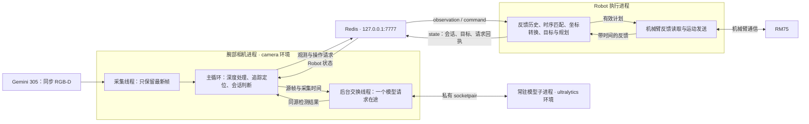
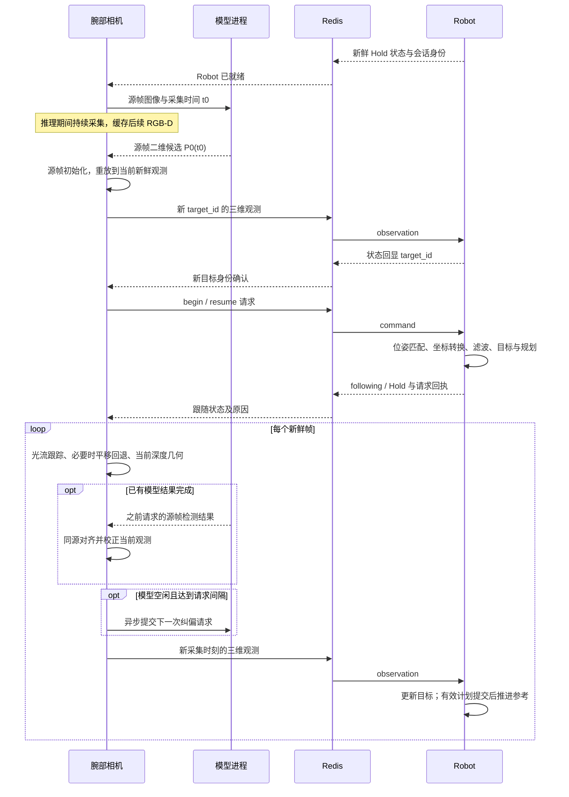
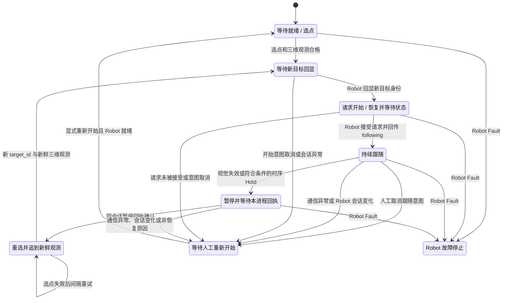

# Camera_wrist 架构

## 业务目标与职责边界

腕部相机提供颈部可见表面的连续观测，供 Robot 生成探头的空中跟随目标。
业务主线是：建立目标 → 持续定位 → 发布观测 → 确认开始 → Robot 规划执行 → 失效后暂停与重建目标。

- **腕部相机进程**负责同步 RGB-D、二维选点与跟踪、相机坐标系下的表面点 / 外法向、观测及跟随请求。
- **模型进程**负责从图像产生二维候选，参与初始选点和持续纠偏。
- **Robot 进程**独占机械臂反馈、按采集时刻进行坐标转换、生成 TCP 参考、规划和运动发送。

主链可以独立于全局相机运行；系统也可以先完成全局粗定位，再进入腕部跟随。
默认使用模型选点，手动模式仅替换初始像素的来源，后续定位和 Robot 请求链相同。
本模块当前用于无接触悬停；接触力闭环和根据到位结果自动切换超声控制尚未接入。
系统启动编排可以在操作者结束腕部阶段后切换进程，见[系统操作](../../.runme/run/system-operations.md)。

## Runtime：运行时结构



采集持续进行，主循环消费最新帧，避免处理队列积压。模型异步推理，等待结果期间继续采集和跟踪；
同一时刻只允许一个模型请求。后台交换线程只负责私有 socket 通信，源帧重放、追踪和融合仍由主循环完成。
相机和模型使用独立 Python 环境；模型通信不经过 Redis，也没有独立 TCP 服务端口。

## 核心业务逻辑序列

### 1. 等待业务就绪，形成带采集时间的 RGB-D

相机确认设备身份、视频流及内参 / 畸变，连接 Redis 并接收 Robot 状态。
模型模式需要新鲜、无 Fault 的 Robot Hold 状态和完整新帧，才进入初始选点。

当前彩色 MJPG / 深度 Y16 均为 640×480 @ 30 FPS，采用 Close Range Default、128 视差。
主跟踪入口的深度先对齐到彩色图像，再依次做 SDK 空间滤波、FURTHEST 补洞和时域平滑。
时域滤波当前帧权重为 0.6，帧间深度变化比例阈值为 0.2；相近深度可融合历史，较大的变化交由 SDK 阈值区分。
保留本帧空间处理 / 补洞后的有效掩码，仍为 0 的位置在时域输出中也保持无效，不能只靠历史深度补成有效观测。
原始深度单独保留，补齐值标明 SDK 估计，正常有效点标明空间及时间平滑来源。

采集间断超过 200 ms、尺寸 / 格式 / 深度尺度变化或处理异常时清除时域历史；重复 / 倒序采集时间拒绝。
SDK 尚未积累出时域输出时跳过该帧，不绕过滤波发布原始值。每个阶段都核对当前帧元数据和采集时间。
此处理不做帧间运动配准，深度数值包含历史贡献，移动时可能有滞后；仍受当前观测时效和有效性检查约束。

每帧保留设备采集时间，并映射到本机单调时钟；采集时刻贯穿检测、追踪、发布与 Robot 位姿匹配。
接收时间、处理时间和心跳时间不能替代采集时间。
配置与深度处理实现见 [gemini_config.py](gemini_config.py)、[sdk_depth.py](sdk_depth.py)。

### 2. 产生初始候选，并从检测源帧追到当前帧

模型检测 `carotid`，默认置信度门槛为 0.4；合格候选中取最高置信度框中心，同分取输出中靠前者。
无合格候选则本次选点失败。手动模式直接提供图像像素，不启动模型进程。
模型候选仅表示二维位置，三维点和表面方向由当前 RGB-D 计算。

异步检测返回的是源帧上的位置，必须执行以下顺序：

1. 核对检测结果与请求源帧的采集时间一致。
2. 在源 RGB-D 帧上初始化跟踪和表面几何。
3. 逐帧重放推理期间缓存的后续 RGB-D，将目标追到新鲜帧。
4. 最终观测合格且足够新鲜后，建立新的 `target_id`；随后发布观测。

选点缓存最多 45 帧；溢出、跟踪失败或无法追到新鲜观测时拒绝本次选点，不把旧检测坐标直接用于控制。
初始模型选点失败可以重试，尚未完成目标确认时不发运动开始请求。
检测规则见[模型服务架构](detector/ARCHITECTURE.md)，赶帧与融合见 [model_selection.py](model_selection.py)。

### 3. 用当前图像跟踪，用当前深度生成三维观测

选点后即持续跟踪，是否允许机械臂运动由后续会话请求和 Robot 状态决定。
每帧先对目标附近的特征做 LK 前后向光流，再按以下顺序更新原目标像素：

```text
当前有效光流点足够
    → 优先拟合局部仿射变换
    → 仿射合格：变换原目标像素
    → 仿射估计 / 共识或候选像素 / 纹理失败：
        用 median(当前点 - 上帧点) 做平移回退
    → 检查更新位置并补充特征
```

回退使用本帧实际通过光流检查的点，不复用旧帧运动或伪造支持点。
RGB-D 跟踪、模型赶帧和独立二维跟踪共享该逻辑。有效光流不足或回退也不合格时，观测失效。

随后用目标像素的处理后深度和去畸变光线反投影：

```text
p_camera = depth(pixel) × [x_normalized, y_normalized, 1]
```

目标周围 10 mm 三维半径内的点云经 RANSAC 平面共识和 SVD 计算法向，法向统一朝相机。
表面点位置直接取目标像素深度；拟合平面用于估计表面方向和验证局部支撑。

持续模型检测与光流并行。返回结果先与同一源帧的历史光流点对齐，再把偏差迁移到当前帧：

```text
当前模型候选 = 当前光流点 + 模型源帧中心 - 源帧光流点
```

同一源帧内，检测框中心与光流目标点的欧氏距离大于 15 px 时，将观测标为丢失。跟随中先等待 Robot 确认暂停，再用新的检测框中心重选并赶到新鲜帧，之后按现有流程恢复。
距离不超过 15 px 时，以 0.25 增益、单次最多 2 px 修正当前点，重新计算当前深度几何并补点。
校正失败保留本帧原有光流结果；超过 1 秒没有成功校正或已对齐确认，则判定模型确认丢失。
几何与跟踪实现见 [local_tracker.py](local_tracker.py)。

### 4. 先交付观测，再确认跟随请求

相机发送观测后，等待 Robot 状态回显同一 `target_id`，再发送首次 `begin` 或后续 `resume`。
目标回显只确认观测身份已被接收，不表示目标可达、规划成功或机械臂已到位。

Robot 独立检查请求、观测、来源和运行会话是否匹配，并决定接受跟随还是保持 Hold。
跟随期间不能直接接管另一个目标；换目标通过暂停、重选和确认恢复完成。
会话流程见 [follow_session.py](follow_session.py)，业务编排见 [click_follow.py](click_follow.py)。

### 5. Robot 按采集时刻生成目标并执行

Robot 用包围观测采集时刻的反馈插值相机位姿，不使用处理时刻的机械臂姿态代替，也不外推。
坐标链和目标关系为（位置单位 m，`T_A_B` 将 B 坐标映射到 A）：

```text
T_base_camera(t) = T_base_armtip(t) × T_armtip_camera
p_surface_base  = R_base_camera × p_camera + t_base_camera
n_out_base      = R_base_camera × n_out_camera
p_tcp_goal      = p_surface_base + 0.050 × n_out_base
Tool-Z 候选     = -n_out_base
```

TCP 目标与实际间距直接使用当前有效表面点和法向，Tool-Z 候选使用同一法向。
相机继续以 30 FPS 采集，Robot 以 200 Hz 生成运动参考。

Tool-X 由上一参考 X 轴投影到新切平面得到，退化则 Hold。
完整姿态候选相对上次接受目标变化超过 15°才更新；开始 / 恢复重新接受当前有效目标。
Robot 从实测 TCP / 关节重建运动参考，按当前位置、姿态及关节步长限制生成候选计划。
当前源码参考限速为 4 mm/s、4°/s，腕部每关节命令步长限速为 4°/s。
TCP 目标相对已提交位置参考的距离大于 7 mm 时启动平移，收敛到 3 mm 内时停止。
死区内继续处理视觉观测，并保留跟随会话。
只有规划和提交成功才推进运动参考。

50 mm 是施加于当前估计表面位置的法向偏置。
实际运动、规划拒绝及硬保护的完整边界见 [Robot 架构](../Robot/ARCHITECTURE.md)。

## Runtime：从选点到跟随的时序

图中模型模式的业务消息均携带原始采集时间和目标身份；观测 / 请求 / 状态经 Redis 传递。



模型请求并非每帧必发；主循环不必等待下一次推理完成即可更新观测。
最多每 0.1 秒尝试提交一次，已有请求在途时继续处理相机帧，不再提交另一请求。
跟随及恢复等待期间约每 100 ms 发送心跳，心跳只维持请求链，不延长观测采集期限。

## 失效、暂停与恢复的业务闭环

观测不可用时发布无效结果；正在跟随则请求暂停。自动恢复需要保留的模型跟随意图，且必须经过本进程的暂停回执。
Robot 主动报告观测过期 / 不匹配或位姿时间未匹配时，也只能在原会话、原目标、原请求归属和无 Fault 的条件下进入该流程。



恢复重选失败可间隔约 0.75 秒重试；该间隔不保证恢复总时长。
恢复始终要求新目标、新鲜三维观测和目标回显；二维跟踪或仅看到 Hold 状态不足以恢复运动。
人工取消、Robot 重启、Redis 发布 / Robot 状态通信异常及不符合恢复条件的拒绝会取消开始或恢复意图。
模型 socket 交换错误只拒绝当次结果，不直接取消已有恢复意图；worker 退出后当前不自动重建。

Hold 表示停止目标跟随，Robot 仍可能发送保持目标。致命故障或进程停止进入停止和静止确认路径。
关节限位等硬保护可使 Robot 退出；视觉恢复不能解除这些故障。关节接近限位时提前减速、避限位或自动换构型尚未实现。

## 进程间契约与关键约束

Redis 实例为 `127.0.0.1:7777`，主链路 scope 为 `click_follow`，坐标单位为 m。

| 消息 | 方向 | 业务内容 |
| --- | --- | --- |
| `robot:wrist:observation:v1` | 相机 → Robot | 相机坐标表面点、外法向、采集时间、像素、质量及有效性 |
| `robot:wrist:command:v1` | 相机 → Robot | begin / resume / pause / end / heartbeat |
| `robot:wrist:state:v1` | Robot → 相机 | 会话、目标身份、请求回执、following / Hold、故障与定位诊断 |

消息通过运行会话、进程来源、目标身份、boot、标定文件摘要、坐标系和递增序号约束归属；
无效、过期、重复乱序或身份不匹配的数据不能借新心跳重新变为有效。
`feature_inliers` 是兼容的支持点数字段，来源由 `tracking_method` / `feature_support_type` 区分：
仿射内点、平移回退的有效前后向光流点，或初选 / 模型校正的纹理点。完整接收检查见 [Robot Redis 接收端](../Robot/src/redis_bridge.cpp)。

| 业务约束 | 当前规则及结果 |
| --- | --- |
| 二维运动依据 | 至少 4 个有效特征；前后向误差 ≤3 px；仿射内点至少 4 个、比例 ≥50%、重投影门限 3 px，否则尝试平移回退 |
| 目标像素 | 标准配置单帧位移 ≤15 px，并满足图内及补点要求；仿射尺度 / 行列式仅诊断 |
| 深度与表面 | 目标深度有效，四邻接至少 2 个深度差 <30 mm；10 mm 邻域平面至少 10 个内点、比例 ≥50%，支撑不得退化 |
| 残差诊断 | 平面 RMS、点到平面距离和三维帧间位移不按旧上限拒绝；这些数值仍记录 |
| RGB-D 时间 | 彩深采集差 ≤20 ms；采集时间递增，连续跟踪帧间隔 ≤200 ms |
| 观测与 Robot 状态 | 采集年龄 / 状态年龄 ≤200 ms；Robot 接收 envelope 年龄另要求 ≤500 ms |
| 反馈插值 | 反馈须包围采集时刻，跨度 ≤100 ms；跟随时若仅缺曝光后的反馈，在观测和反馈仍满足时效门时保留会话并暂停下发新目标，补齐后继续跟随 |
| 异步模型结果 | 普通纠偏源帧年龄 ≤500 ms 并有同源历史；选点重放检查最终观测 ≤200 ms，继续赶帧最多 2 秒 |
| 请求存活 | 心跳约 100 ms，命令超过 500 ms 不再保持跟随授权；不替代观测时效 |

## 全局点投影核验支线

[投影核验入口](projection_preview.py)读取粗定位写入的 `robot:wrist:seed:v1`，校验会话、相机身份、有效期及双标定摘要，
再按采集时刻把基座表面点反投影到腕部图像，比较理论位置 / 深度和当前观测。
可附加本地跟踪，但只写诊断日志，不发布主链观测或运动请求。
该支线 scope 为 `projection_preview_only`，不作为模型 / 手动跟随的目标接管来源。

## 运行记录与交付边界

定位异常按同机单调时间串联两侧记录：相机 JSONL 说明观测和请求为何变化；
Robot 的 `runtime.csv.wrist.csv` 记录表面点、法向、目标、位姿匹配和规划结果；
`runtime.csv` 与 `runtime.summary.json` 说明实测反馈、提交行为和首个停止原因。
相机状态超时可能是 Robot 已故障的后果，自动暂停也可能记录为 `operator_paused`，需按事件顺序判定。

当前[腕部 Robot 启动脚本](start_robot.sh)启用真实执行、候选外参、无力传感模式，并关闭累计位移 / 转角及 TCP 位置跟踪误差门。
关节、规划、通信、周期和停止保护仍由 Robot 处理。当前[手眼外参](gemini305_to_rm75_armtip.json)的独立验证记录仍为 false；
程序接受观测、回显目标或规划通过，均不代表实际定位精度、悬停间距及工具净空已验收。

启动和人工操作见[腕部操作](../../.runme/run/camera-wrist-operations.md)，
标定见[标定操作](../../.runme/run/calibration_camera.md)，
实际运行、验证及待办见[腕部进展](../../.runme/Progress/camera-wrist-progress.md)，
控制器职责见[Robot 架构](../Robot/ARCHITECTURE.md)。
