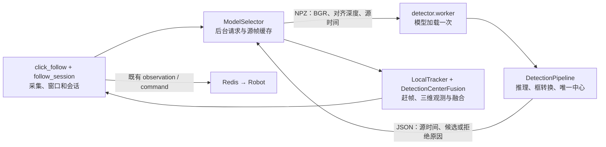
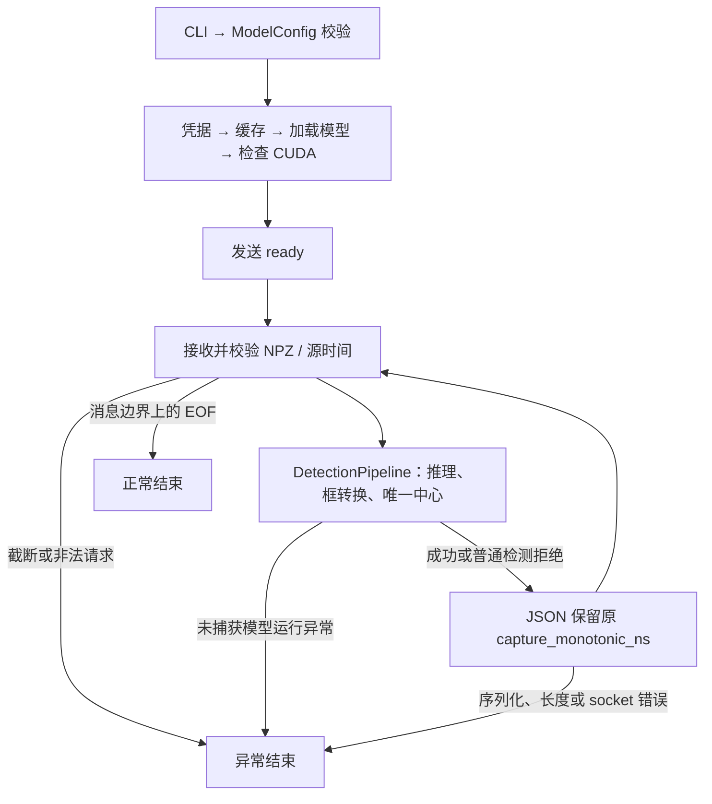

# 腕部模型服务 detector 架构

本文依据 **2026-10-02 当前工作区源码**。原 `infer/Carotid_begin/` 模型代码已并入
`Camera_wrist/detector/`；本子包负责模型加载和单帧检测，以唯一合格检测框中心返回
初始扫描点 P0 的二维候选。RGB-D 采集、光流、深度几何、融合和跟随会话由腕部主模块管理，
整体流程及 Robot 协议见 [Camera_wrist 架构](../ARCHITECTURE.md)。

候选通过程序门限不等于扫描位置已由独立真值确认；模型加载或检测不会直接发起机器人运动。
真实目标连续跟踪、自动恢复、外参和动态定位精度仍待验收，历史 GPU/硬件记录见
[模型进展 notebook](../../../.runme/Progress/carotid-begin-progress.md)。

## 职责与进程边界

相机进程使用 `camera` Conda 环境，模型子进程使用 `ultralytics` 环境。
`ModelSelector` 创建私有 `socketpair` 并启动模型 worker；没有独立 TCP 服务端口。
相机后台线程交换请求，采集、赶帧、跟踪和窗口事件仍由相机主循环执行。
模型进程加载一次模型，串行回复帧请求，同一时刻只有一个请求在途。



| 文件 / 入口 | 职责 | 边界 |
| --- | --- | --- |
| [config.py](config.py) · `DEFAULT_MODEL_ID`、`ModelConfig` | 默认模型 ID、不可变配置及 ID/类别/置信度/边距校验 | 非法配置在凭据读取和模型加载前拒绝 |
| [credentials.py](credentials.py) · `get_api_key` | 优先读环境变量，再读本机私有凭据 | 密钥不进入帧协议、Redis 或日志 |
| [gpu_model.py](gpu_model.py) · `load_cuda_model` | 加载 Roboflow 模型并检查 provider 和实际模型会话 | 必须包含 `CUDAExecutionProvider` |
| [detection.py](detection.py) | 原生响应转原图框，选择唯一合格框中心 | 输出二维 `scan_start`，不做深度反投影 |
| [pipeline.py](pipeline.py) · `DetectionPipeline.process` | 注入模型、推理、框转换、选点和响应组装 | 不管理凭据、socket、深度几何或 Robot 请求 |
| [protocol.py](protocol.py) | RGB-D 校验、NPZ 编解码、受长度约束的 JSON 发送 | 保留源时间，禁用 pickle 和非有限 JSON 数值 |
| [worker.py](worker.py) · `main`、`serve` | CLI、加载模型、ready 握手、常驻顺序服务 | 仅响应相机，关闭时释放 socket |
| [model_selection.py](../model_selection.py) | 子进程生命周期、后台交换、赶帧与同源帧融合 | 不发布 Redis 命令，worker 退出后不自动重建 |
| [follow_session.py](../follow_session.py) | 会话、单键开始、暂停回执和恢复意图 | 运动请求必须经过既有会话与状态校验 |

## 配置与启动

日常相机启动见 [最简启动 notebook](../../../.runme/run/carotid-begin-operations.md)。
`bash infer/Camera_wrist/start_camera.sh` 和 `camera` 环境内直接运行
`python infer/Camera_wrist/click_follow.py` 均默认模型模式；无需传入参数。

模型 ID 优先级为 **显式 `--model-id` → `CAROTID_MODEL_ID` 环境变量 → `DEFAULT_MODEL_ID`**。
当前默认 ID 是 `songjiatong/carotid-detect-c9gi9-9-rfdetr-small-t1`。
`--manual` 切换鼠标选点跟踪，不启动模型子进程。

| 配置 / 检查 | 默认规则 | 可调整入口 |
| --- | --- | --- |
| 类别 | 精确匹配 `carotid` | 相机 `--model-class` |
| 模型出框 / 选点置信度 | 均为 0.4 | 相机 `--model-confidence` 修改选点阈值；当前调用固定推理阈值 0.4 |
| 唯一性 | 类别和置信度过滤后恰好 1 个候选；多框不取最高分 | `scan_start_from_boxes` |
| 坐标 | 响应图像尺寸与输入一致；正框尺寸，合格框不越原图 | `detection.py` |
| P0 与边距 | 检测框中心，默认额外边距 0 px | `ModelConfig.margin`；跟踪器另检查纹理/深度 |
| worker Python | 本机 `ultralytics` 环境 | 相机 `--detector-python` |
| 模型缓存 | `Camera_wrist/data/model_cache/`，Git 忽略 | `MODEL_CACHE_DIR` 环境变量 |

模型进程入口为 `python -m infer.Camera_wrist.detector.worker`。它由 `ModelSelector` 传入
必需的 `--socket-fd` 和 `--model-id` 等参数；直接启动 worker 不是相机运行入口。
初始化时相机为子进程装配 CUDA/cuDNN 和可用的 MKL 库路径。
`gpu_model` 使用 `device='cpu'` 输入路径避免额外 PyCUDA 依赖；ONNX 会话同时配置 CUDA
和 CPU provider。provider 检查证明 CUDA 已启用，不证明每个算子都在 GPU 执行。

凭据优先从 `ROBOFLOW_API_KEY` 读取，否则使用迁移前已保存的
`~/.config/carotid_begin/roboflow_api_key`。该旧目录名继续兼容，无需重录密钥。
读取要求普通文件且无组/其他用户权限；保存工具写入 `0600`，不打印密钥。
在仓库根目录检查凭据：

```bash
/home/cair-jacen/anaconda3/envs/ultralytics/bin/python -m infer.Camera_wrist.detector.credentials check
```

## 私有帧协议

所有消息为 **4 字节网络字节序无符号长度 + 正文**。该协议只用于相机与模型服务之间，
Robot Redis 公共协议不随目录迁移改变。

| 消息 | 编码 / 正文上限 | 字段与语义 |
| --- | --- | --- |
| 帧请求 | NumPy NPZ，16 MiB，`allow_pickle=False` | `image`：非空 `uint8 H×W×3` BGR；`depth`：同尺寸 `float32 H×W`；`meta`：JSON 对象，含非负整数 `capture_monotonic_ns` |
| ready | UTF-8 JSON，4096 字节 | `{"ready":true,"model_id":"…"}`；相机要求 ID 与启动配置完全一致 |
| 逐帧结果 | UTF-8 JSON，65536 字节 | `valid`、原始 `capture_monotonic_ns`；相机复核源时间与请求一致 |
| 有效候选 | 同上 | `prediction` 含 `scan_start:[x,y]`、`confidence`、`box_xyxy`、`class_name` |
| 检测拒绝 | 同上 | `valid:false`、`reason`；正常拒绝后继续接收下一帧 |
| 预览信息 | 框转换成功后才存在 | `detections`、`image_size:[W,H]`、`inference_ms`；无合格框或多候选也可带这些字段 |

深度随请求传输，协议只检查类型和形状，`DetectionPipeline` 只消费 BGR。
有效深度、局部表面和法向由相机端计算。`inference_ms` 仅计 `model.infer`，
不含传输、后处理、赶帧或端到端延迟。



## 故障与时效

| 条件 | 模型服务 / 相机行为 |
| --- | --- |
| 配置、凭据、模型加载或 ready 失败 | 相机启动失败；`ModelSelector` 关闭 socket 并终止子进程 |
| 无目标、多候选、非法框或管线捕获的 `ValueError/TypeError/KeyError` | 拒绝当前帧，worker 继续接收 |
| 截断、非法帧、未捕获运行异常或发送错误 | worker 结束，后台线程将交换错误交给相机主循环 |
| 完整消息边界上相机关闭 socket | worker 正常结束 |
| 选点中的交换错误 | 拒绝本次选点，不建立新目标或开始请求 |
| 预览中的交换错误 | 记录错误，有效光流可暂时继续；错误不刷新模型确认时间 |
| worker 已退出 | 当前不自动重建；退出并重新启动相机入口 |

ready 的 socket 操作 timeout 为 60 s，逐帧交换为 15 s；均不是观测有效期或整体耗时保证。
相机新选点从源帧初始化后赶到新鲜帧，最终观测年龄要求 ≤200 ms；普通融合另要求检测
源帧年龄 ≤500 ms。超过 1 s 无模型确认会锁存视觉丢失，已有跟随意图时走暂停确认和重选流程。
记录模型错误本身不能视为 Robot 已暂停；暂停、回执、目标确认和恢复由
[follow_session.py](../follow_session.py) 与相机入口共同管理，详见 [腕部架构](../ARCHITECTURE.md)。

## 离线检查与验证边界

模型服务测试统一位于 `Camera_wrist/tests/`：

| 证据入口 | 可验证范围 |
| --- | --- |
| [test_credentials.py](../tests/test_credentials.py) | 环境变量优先、私有文件读取和权限校验 |
| [test_detector_worker.py](../tests/test_detector_worker.py)、[test_detection_protocol.py](../tests/test_detection_protocol.py) | 假模型下配置、框转换、消息边界、多帧服务、源时间及异常处理 |
| [test_model_selection.py](../tests/test_model_selection.py)、[test_tracker.py](../tests/test_tracker.py) | 合成 RGB-D 赶帧、同源帧融合、校正限幅与丢失锁存 |
| [test_model_start.py](../tests/test_model_start.py)、[test_click_session.py](../tests/test_click_session.py) | 会话身份、目标回传、暂停回执、开始/恢复和取消条件 |
| [loopback_check.py](../tests/loopback_check.py) | 隔离 Redis 与模拟 Robot 的端到端交互 |

在仓库根目录运行相关离线测试：

```bash
/home/cair-jacen/anaconda3/envs/camera/bin/python -m unittest discover -s infer/Camera_wrist/tests -v
```

这些检查不替代真实 CUDA 推理、相机运行或机械臂运动验收；历史通过数也不代表当前回归数。
本次迁移的实际检查见 [腕部进展](../../../.runme/Progress/camera-wrist-progress.md)。
模型诊断仍由相机写入 `Camera_wrist/log/wrist_click_*.jsonl`，原独立模型日志归档于
`Camera_wrist/log/carotid_begin/`。按源单调时间和 `reason` 区分无目标、普通拒绝与进程故障；
融合与 Robot 日志的关联方式见腕部架构及操作 notebook。
