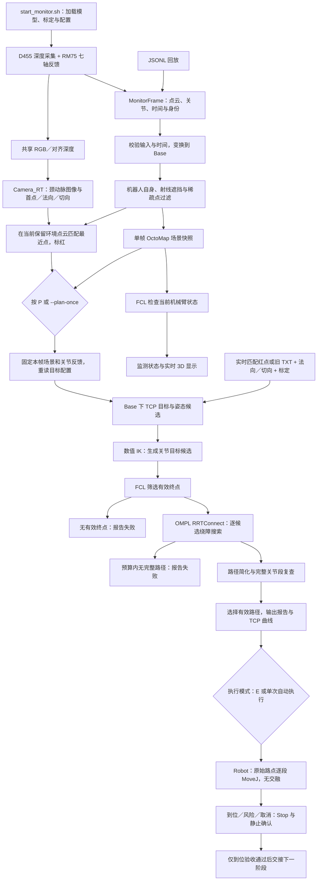

# Collision 系统架构

Collision 是全局相机辅助粗定位的独立 C++17 模块，负责环境建模、整臂碰撞检查、
目标关节构型求解、绕障路径搜索和结果预览；显式执行模式通过 Robot C++ 库沿关节路径运动。
沿用现有工程，不依赖 ROS 2，Collision 核心不使用 Python。

本文件描述核心业务和运行时关系。操作命令见 [MONITOR.md](MONITOR.md) 与
[PLANNING.md](PLANNING.md)，实施路线见 [README.md](README.md)，
执行入口与约束见 [EXECUTION.md](EXECUTION.md)，变更、验证结果和待办见 [PROGRESS.md](PROGRESS.md)。

## 业务范围与系统关系

输入包括 D455 深度观测、RM75 七轴反馈、URDF／网格、相机外参、工具 TCP 标定，
以及上游保存的颈动脉点、外法向和血管切向。输出为当前状态的碰撞报告、
关节路径、目标构型预览和末端 TCP 曲线。

相机观测中保留下来的非机器人点统一作为环境障碍物，包括人体、床和设备。
本模块不区分人体类别，也不预测人体运动。

Collision 独立打开相机，不依赖 Redis。默认通过只读连接查询机械臂状态；
执行模式由 [Robot 执行器](../Robot/include/joint_path_executor.hpp)提供同一连接的反馈与运动发送，
相机源不再另开状态连接。该模式不启动 main_rm75 的力控／腕部状态机，也不调用 MoveJ_P。

`--carotid` 双窗口模式只由 C++ 打开 D455。RGB／对齐深度通过临时会话文件共享给既有
Camera_RT 识别进程，返回首点、法向、切向和源帧身份；C++ 完成 Base 变换及最近点映射。
识别推理保留现有 Python 实现，碰撞、映射、规划和执行为 C++。

## Runtime：运行时业务流转

### 1. 启动与数据接入

[start_monitor.sh](start_monitor.sh) 解析本地资源位置并启动 `collision_monitor`，
默认加载 [rm_75.urdf](rm_75.urdf)、[监测配置](config/monitor.example.json)和
[粗定位目标配置](config/coarse.goal.example.json)。显式参数可覆盖默认值。
URDF 是运行输入；[Xacro](rm_75.urdf.xacro) 是模型维护源，加载器不会自动展开 Xacro。
RealSense 接入使用下载的 SDK 头文件与预编译运行库。

实时模式通过 SDK 取得深度点云，同时从机械臂状态历史中匹配相近时刻的七轴反馈，
封装为 `MonitorFrame`。回放模式从 JSONL 读取相同帧结构，不连接设备。
可选录制保存原始输入及有效标志，供回放时重新处理。

### 2. 每帧处理与环境建模

处理器检查相机和标定身份、关节完整性与限位、采集时间可信度、
帧龄及相机与反馈的时间偏差。输入无效时报告原因，不使用该帧发起规划。

有效帧依次经过以下处理：

1. 将 depth optical 点和射线原点变换到 color optical，再通过相机外参变换到 Base。
2. 根据采集关节姿态计算整臂及附件位置，标记机器人自身点。
3. 剔除机器人表面及其射线遮挡后方的点，过滤稀疏离群点。
4. 用保留观测的自由射线和占据端点建立单帧 OctoMap，形成不可变 `CollisionScene`。
5. 使用 FCL 检查当前构型的自碰撞、环境碰撞和净空，按监测策略检查未知空间。
6. 输出监测状态并更新窗口，随后处理下一帧。

每帧重新建图，不跨帧持久融合。无效深度、遮挡、被过滤端点的保护区域及观测范围外保持未知；
已观测占据优先于自由证据。过滤掉一个点不表示对应空间已证明无障碍。

### 3. 规划触发与目标生成

窗口按 **P**，或使用 `--plan-once` 时，应用固定当前有效帧的场景及反馈关节角，
重新读取目标配置。监测报告存在碰撞或未知空间，不等同于输入无效；
是否能规划，由本次规划的起点、目标和路径检查共同决定。

粗定位模式读取颈动脉文件的首点、外法向和血管切向，通过相机外参生成 Base 下的表面目标。
双窗口模式改用本会话识别包，在当前有效环境点中选欧氏最近点作为表面点并标红，
不读旧 TXT。只接受相机／标定／会话匹配且源帧年龄不超过 2 s 的识别结果；两窗口异步更新。
按 P 时固定红点和当前场景，映射距离、原始点、实际使用点及源／场景帧号进入完整报告。
TCP 目标位置为表面点沿单位外法向后退 `standoff_m`；日常配置为 **0.10 m**。
名义姿态使 TCP +Z 朝内，+X 沿投影后的血管切向。

目标位置保持固定，按配置尝试五种姿态：原姿态、TCP 局部 Y+9°、X+9°、X−9°、Y−9°。
正负角表示绕局部轴按右手定则旋转；每个收敛解的 TCP −Z 与原外法向偏差须不超过 10°。
该角度约束只作用于终点。

工具标定提供 Link7 到探头 TCP 的变换，数值 IK 使用同一 URDF 的 FK 和关节限位求解，
对候选去重并按与当前关节角的距离排序。CAD 中的附件原点不作为探头 TCP。
若输入的是目标关节角 JSON，则直接进入关节目标规划，跳过 TCP 目标生成和 IK。

### 4. 候选筛选与绕障路径搜索

先检查各个 IK 终点的整臂碰撞和净空，不合格候选不进入 OMPL 搜索。
对有效候选，按剩余候选数分配剩余时间和查询预算，逐一运行七轴关节空间 RRTConnect。
日常配置的总预算为 60 秒，包含 IK、检查、搜索、简化及最终复查；IK 另有自身限时。

OMPL 在关节空间采样并连接状态，FCL 提供状态和连接段的有效性判据。
搜索可以产生绕障的中间关节构型，末端路径不要求为直线。
每条连接段按关节坐标线性插值，以距离和保守位移界递归检查，不能只检查两端。

找到路径后继续尝试其他有效候选，最终从完整复查通过的路径中选择关节空间折线长度较短者，
不保证全局最优。所有终点不合格时返回 `invalid_goal`；未找到 IK 或预算内没有完整路径时
分别报告原因，不把超时当作不存在路径的证明。

### 5. 结果输出与可视化

规划成功后输出已检查的关节路点，沿相同的关节线性路径采样 FK，
再乘本次 TCP 标定生成末端曲线。失败时显示 `NO PATH` 和原因，不生成替代路线。

目标预览固定本次规划的场景、采集构型和候选几何，可显示违规部件与最近距离线；
**G** 在目标快照和实时监测之间切换。过期曲线标记为历史快照，重新规划后替换。

默认终端仅显示关键状态、耗时、路点数和主要失败原因；`--verbose` 输出完整候选、
路径和诊断数据。路径结果的 `ready_for_execution=false` 表示尚需执行前检查；执行模式另行输出执行事件。

### 6. 可选关节路径执行

显式 `--execute` 才创建 Robot 执行会话。P 规划，E 开始，空格取消；
`--execute --plan-once` 将完整规划接到自动执行，以执行验收决定退出码。
全局采点脚本的 `--collision` 分支调用同源双窗口入口，C++ 始终独占 D455。

执行器检查起点与至少 3° 关节限位裕量，依次对 OMPL 原始路点发送 MoveJ，
不插入 2° 运动路点；r=0、trajectory_connect=0，不交融、不预排运动队列。
同一 I/O 线程发送运动、查询状态并处理 Stop；接受回执和到位事件分别处理，到位后再核对实际关节。
默认 movej_velocity_percent=6，控制器负责插补和加减速；它不等价于此前的 30°/s 上限。
按 E 时用当前有效快照一次性复查完整路径，通过后启动执行；快照复查时钟固定，不在运动中续期。
执行线程独立检查反馈、控制器错误、限位和相对活动关节线段的偏差。
首次停止诊断冻结于触发时，包含关节偏差、反馈年龄及执行阶段，随 execution_result 输出一次。
运行中的相机场景监督已取消：不检查新点云中的剩余路径，不等待许可或要求 500 ms 续期。
点云和当前状态的碰撞报告仍显示，但新增／移动障碍物不会触发相机避障停止。
机器人反馈异常、路径偏差、取消或整个会话退出仍停止并确认静止。
运动中断或协议失败后重启本会话，防止旧到位事件被误用于下一条 MoveJ；控制器实际插补路径仍待实测。
终点再检查关节、FK TCP 误差和静止状态，全部通过后自动关闭点云窗口并返回 0，
启动器清理识别进程／颈动脉窗口后，上层一键流程自动交接腕部；失败不进行阶段交接。

## 运行时组织与数据契约

主线程依次完成采集／回放、建图、检查、输出和绘图。按 P 后在主线程同步规划，
搜索期间暂停该进程的逐帧处理，此阶段不执行运动；执行时相机主循环继续建图并提供场景许可。
默认实时源另有机械臂反馈线程，通过受限只读封装查询并维护反馈历史。
执行模式消费 Robot 共享反馈缓存；有主机接收时间，没有逐帧查询 RTT，不伪造请求时间。
运动线程独立于相机主循环，因此相机阻塞时许可过期仍能触发停止。

机器人几何在检查器中保持不可变；规划复用本次只读场景，不在搜索过程中混入后续相机帧。
实时规划受快照剩余有效期约束，结束后复查时效。回放使用记录时基。

| 数据 | 核心内容 |
| --- | --- |
| `RobotModel` | URDF 结构、关节限位、逐连杆 FK、网格与模型身份 |
| `MonitorFrame` | 点云、射线原点、七轴反馈、序号、采集／反馈时刻及有效标志 |
| `CollisionScene` | 不可变占据观测或人工场景、采集姿态上下文、场景及标定身份 |
| `StateCheck`／`SegmentCheck` | 有效性、失败原因、违规部件、距离及未知空间诊断 |
| `PlanResult` | 规划状态、关节顺序、完整路点、起终点检查及场景／模型／标定身份 |

统一使用 Base 坐标、m、rad、ns；`T_A_B` 将 B 坐标映射到 A。
在线时间使用本机单调时钟，曝光时间与接收时间分别处理；机械臂反馈没有设备采样时间，
当前匹配依赖主机接收记录，不构成相机与机械臂硬同步。

## 几何与空间策略

模型包含机械臂、相机、连接件、力传感器、探头和固定圆柱支撑。
STL 经 Qhull 构造填充凸包交给 FCL，基本体保留实体表示；显示使用原始 STL。
因此视觉空隙可能被凸包覆盖，碰撞结果应以实际查询几何解释。

关节限位裕量由 `joint_limit_margin_deg` 控制，日常为 3°，执行至少 3°。
IK、OMPL 边界和状态／路径段复查使用同一收缩区间，执行另核对 Robot 的限位。
自碰撞排除表仅豁免指定连杆对，包括固定附件内部、活动关节相邻连杆及支撑安装接触。
这些部件仍参与环境检查，其他连杆对继续检查；模型和排除策略参与身份校验。

未知空间策略由请求明确指定：

- 严格模式要求运动部件相关区域有自由证据，采集姿态中完全属于机器人实体的体素可使用自身覆盖依据；
  固定到 Base 的底座和支撑不要求自由空间证明，但仍参与碰撞检查。
- 日常粗定位配置 `allow_unknown_space=true`，允许目标和路径进入未知区域，
  保留已观测障碍物、自碰撞、净空、关节限位和时效检查；成功不证明未观测区域无障碍。

日常配置还跳过独立起点预检查，但仍检查 OMPL 状态与连接段。
目标文件年龄及点云匹配距离门限默认关闭，允许使用旧目标；
相机标定身份、目标机器人遮挡以及实时输入时效检查保留。
配置定义见 [监测配置](config/monitor.example.json)和[目标配置](config/coarse.goal.example.json)。

## 核心模块与入口

| 模块／入口 | 职责与源码 |
| --- | --- |
| 几何模型 | [robot_model.cpp](src/robot_model.cpp)、[mesh.cpp](src/mesh.cpp)：URDF、STL、FK 与资源身份 |
| 碰撞与占据 | [collision_checker.cpp](src/collision_checker.cpp)、[voxel_scene.cpp](src/voxel_scene.cpp)：FCL 状态／路径段检查及空间证据 |
| 数据接入与处理 | [live_source.cpp](src/live_source.cpp)、[robot_read_only.cpp](src/robot_read_only.cpp)、[monitor.cpp](src/monitor.cpp)：采集、反馈匹配、过滤和建图 |
| 目标与规划 | [coarse_target.hpp](apps/coarse_target.hpp)、[pose_ik.cpp](src/pose_ik.cpp)、[joint_planner.cpp](src/joint_planner.cpp)：目标构造、IK、候选搜索与复查 |
| 监测应用与窗口 | [collision_monitor.cpp](apps/collision_monitor.cpp)、[monitor_viewer.cpp](apps/monitor_viewer.cpp)：运行编排、报告、目标及路径预览 |
| 离线工具 | [collision_inspect.cpp](apps/collision_inspect.cpp) 审计模型；[collision_check.cpp](apps/collision_check.cpp) 检查状态／关节段；[collision_plan.cpp](apps/collision_plan.cpp) 搜索、保存及复查人工场景路径 |

Robot 力标定工具可复用碰撞库检查自碰撞与关节段，不消费相机场景，
与上述实时相机规划是独立入口。构建依赖与可选开关以 [CMakeLists.txt](CMakeLists.txt) 为准。

## 执行边界

默认及回放模式不发送运动或停止指令，不能用它们保护其他进程控制的机械臂。
执行模式仅控制本会话运动，关闭窗口或退出时请求停止并检查静止。
执行器、生产 main_rm75 与 arm_probe_pose 共享本机运动锁；其他主机或未使用锁的工具仍需人工排他。

当前监督逐段检查新观测，不预测人体轨迹，也未证明跟踪误差／停止扫掠完全处于几何净空内。
自动静止后重规划、连续动态绕行和接触扫描允许接触策略尚未接入。
执行沿已检查的关节路径进行，不将终点交给 MoveJ_P，也不重新求 IK 替换构型。
整机关系见[项目架构](../../ARCHITECTURE.md)。
