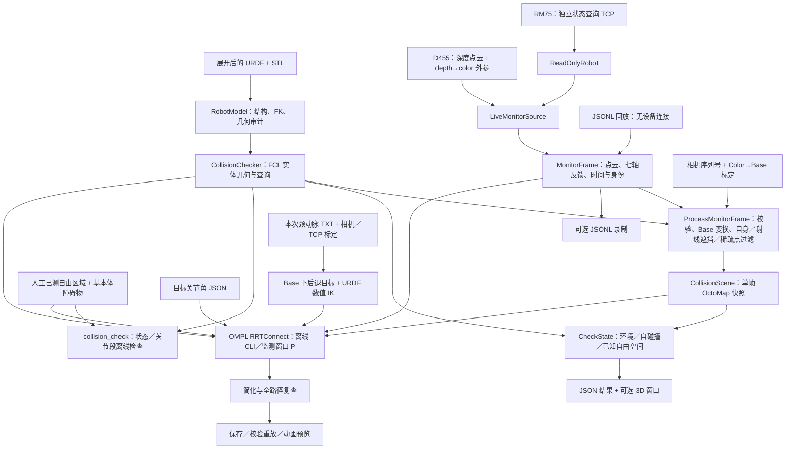

# Collision 系统架构

2026-11-04 目标姿态扩展：在固定 TCP 目标位置上采样绕原外法向的旋转与 9° 倾斜，
对实际 IK 终点用 FK 核验 TCP -Z 与原外法向的偏差不超过 10°。当前不额外绕法向旋转，按原姿态、TCP 局部 Y+9°、X+9°、X-9°、Y-9° 采样 5 种姿态，
每姿态最多 1 个候选，共享 4 秒 IK；总规划仍 60 秒。先筛目标，再为所有有效候选分配搜索时间，
预览、目标矩阵和输出跟随选中姿态，不能只把不同关节构型视为不同工具姿态。
该角度约束作用于终点，不限制整条路径的朝向；地图、碰撞阈值和执行权限不变。

2026-11-04 补充：目标净空诊断通过 `CollisionChecker::PreviewBodies` 导出实际 FCL 凸包／基本体，
窗口保留同一规划快照、采集构型及目标候选，不混合后续点云。净空违规增加可选 Base 最近点，
以原 STL／目标凸包／占据体素及最近距离线对照排查。P 更新、G 切换，详见 [MONITOR.md](MONITOR.md)。

规划路径显示沿已检查的关节线性插值路径采样 FK，粗定位乘本次 TCP 安装变换，绘制探头 TCP 曲线。
曲线在模型上层显示，过期保留为橙色历史快照，不作当前有效性或运动执行凭据。
目标快照标题优先保留规划状态，无解／超时时标记 NO PATH；成功曲线自动调整视角。
单次规划 Context 内缓存有效状态和已认证完整段（各最多 4096），仅同一场景／模型／策略／时钟上下文复用，
命中前仍检查取消与预算；最终路径验证可复用该静态场景证书，不等同于新帧验证。
整段认证逐碰撞对保存距离，并扣除该对的相对位移上界。环境对使用对应连杆的位移；
自碰撞对仅累计不共同的活动祖先关节，共同祖先产生的同一刚体变换不影响两部件间距。
未知空间严格模式仍使用全局位移界认证覆盖。新增 `segment_state_checks` 统计段内递归状态检查，
避免仅从外层 `segment_queries` 低估计算量；相关数据只增添诊断，不改变碰撞阈值或认证失败规则。

更新日期：2026-11-04。本文描述当前源码结构及运行边界；构建、启动、录制与回放见
[MONITOR.md](MONITOR.md)，分阶段实现路线及验收清单见 [README.md](README.md)。

Collision 是 USPilot 的独立 C++17 感知、几何检查与离线规划模块。
生产主链路仍是“超声推理／腕部观测 → Redis → Robot → RM75”，Collision 当前不参与运动发送。
本文件统一记录系统概览与源码分层，实际进展见 [PROGRESS.md](PROGRESS.md)，离线规划操作见 [PLANNING.md](PLANNING.md)。

日常入口（仓库根目录）：

终端默认只显示规划状态、耗时、路点数及主要失败原因；详细起终点／候选／未知空间诊断均归入 `--verbose`。
独立监测仅报告状态或风险对象变化。`--verbose` 恢复完整 JSON，原始帧录制不受影响。

```bash
./infer/Collision/start_monitor.sh       # 真实设备只读粗定位规划，按 P 触发
./infer/Collision/start_monitor.sh --monitor-only  # 仅监测，不加载规划目标
./infer/Collision/start_plan.sh          # 合成七轴场景离线规划
./infer/Collision/start_plan.sh --preview
./infer/Collision/start_monitor.sh --plan-once --headless  # 无窗口规划一次
```

[start_monitor.sh](start_monitor.sh) 提供日常无参数启动：默认只读实时监测，自动装配本仓库资源路径、
机械臂地址及本机动态库路径，显式参数可覆盖。传入 `--replay` 时不注入实时模式及默认地址；
原生 C++ CLI 保持显式参数接口，脚本不触发构建或 SDK 下载。

## 定位与实现状态

Collision 为全局相机辅助粗定位提供纯 C++17 几何和碰撞检查能力，沿用现有工程，不依赖 ROS 2 或 Python。
当前可独立进行 URDF／STL 审计、静态场景状态／关节段检查、人工场景 OMPL 规划及 D455／RM75 只读监测。
监测将所有非机器人深度观测作为障碍物，包括人体、床和设备；没有人体分类或人体运动预测。

| 范围 | 当前状态 |
| --- | --- |
| 机械臂与附件 | 13 个连杆、7 个活动关节、5 个固定关节；12 个 STL 加 1 个实心圆柱支撑，逐连杆 FK、资源审计和模型摘要已实现 |
| FCL 检查 | 实体自碰撞、环境碰撞、距离、未知空间检查和关节线性路径段检查已实现 |
| 感知与显示 | 下载的 RealSense SDK 接入、独立机械臂状态读取、单帧 OctoMap、JSONL 录制／回放、GLFW 显示已实现 |
| 软件验证 | 已有构建、离线夹具、回环通信和虚拟显示启动验证；具体边界见本文验证部分 |
| 实机验收 | 相机／机械臂联机、装配包络、空间误差、时序和性能仍需实测 |
| 离线规划 | OMPL RRTConnect、检查约束的路径简化、完整复查、保存／校验重放和关节动画已实现；CLI 当前输入人工场景 |
| 相机规划 | `collision_monitor --goal JSON` 在按 P 或 `--plan-once` 时将当前反馈与 OctoMap 快照交给现有规划器；成功与否均输出诊断 |
| 粗定位目标／IK | C++ 读取颈动脉点／法向／切向，复用相机及 TCP 标定生成后退目标，多初值有界 IK 和候选碰撞／路径检查已接通 |
| 后续集成 | 时间参数化、生产反馈桥接、Robot 执行交接、停止确认及重规划尚未接入 |

## 当前数据流



图中没有运动发送通道。`collision_monitor` 不发送 MoveJ、ServoJ、Hold 或 Stop；发现风险仅输出结果和显示颜色。
JSON 中 `robot_motion_enabled`、`ready_for_motion_planning` 均保持 `false`。
`input_valid=true` 表示输入处理有效；是否满足当前模型和场景的检查条件，应另外读取 `status`。
进程返回成功也不表示空间已验收或允许运动。

## 代码分层与入口

所有公共 C++ 类型位于 `uspilot::collision` 命名空间，接口与实现对应如下。

| 层 | 接口／实现 | 职责 |
| --- | --- | --- |
| 几何基础 | [robot_model.hpp](include/collision/robot_model.hpp)、[robot_model.cpp](src/robot_model.cpp)、[mesh.cpp](src/mesh.cpp) | 解析 URDF、关节校验、逐连杆 FK、碰撞 origin、STL 加载、显式资源映射与 SHA256 |
| 碰撞查询 | [collision_checker.hpp](include/collision/collision_checker.hpp)、[collision_checker.cpp](src/collision_checker.cpp) | 不可变机器人几何、实体凸包、自身点过滤、状态／路径段检查、距离及失败原因 |
| 离线规划 | [joint_planner.hpp](include/collision/joint_planner.hpp)、[joint_planner.cpp](src/joint_planner.cpp) | 有界转动关节空间 RRTConnect，复用状态和关节段检查，局部种子、预算／取消、简化及最终复查 |
| 粗定位目标与 IK | [coarse_target.hpp](apps/coarse_target.hpp)、[pose_ik.hpp](include/collision/pose_ik.hpp)、[pose_ik.cpp](src/pose_ik.cpp) | TXT 到 Base TCP 的几何计算、源与标定身份、目标年龄／点云支持、有界阻尼最小二乘 IK 及候选规划 |
| 占据观测 | [voxel_scene.hpp](include/collision/voxel_scene.hpp)、[voxel_scene.cpp](src/voxel_scene.cpp) | 保存只读 OctoMap、ROI 和已知自由空间查询预算 |
| 监测处理 | [monitor.hpp](include/collision/monitor.hpp)、[monitor.cpp](src/monitor.cpp) | 标定加载、输入校验、坐标转换、机器人过滤、半径邻域离群点过滤、射线建图、调用状态检查 |
| 状态适配 | [robot_read_only.hpp](include/collision/robot_read_only.hpp)、[robot_read_only.cpp](src/robot_read_only.cpp) | 封装连接／状态查询／关闭；转换七轴反馈并记录请求和接收时刻 |
| 实时采集 | [live_source.hpp](include/collision/live_source.hpp)、[live_source.cpp](src/live_source.cpp) | 管理一个相机入口和状态采集线程，生成与回放共用的帧结构 |
| 应用与显示 | [collision_monitor.cpp](apps/collision_monitor.cpp)、[monitor_viewer.cpp](apps/monitor_viewer.cpp) | 参数、实时／回放选择、录制、逐帧 JSON、3D 窗口及退出 |

四个程序入口分别承担：

- [collision_inspect](apps/collision_inspect.cpp)：审计模型及网格，与既有 RM75 MDH 比较；不连接任何设备。
- [collision_check](apps/collision_check.cpp)：读取人工 JSON 场景，检查状态或指定关节线性段；不进行路径搜索。
- [collision_monitor](apps/collision_monitor.cpp)：读取实时源或回放源，逐帧建图并检查当前关节状态；目标 JSON 可输入关节角或颈动脉粗定位配置，后者先求 TCP 目标及 IK 再规划；未接执行监督。
- [collision_plan](apps/collision_plan.cpp)：读取人工场景和七轴起终点，搜索精确路径，保存／重新校验重放及可选预览；无设备 I/O，未接 IK。

## 模型、几何与查询语义

模型链为 `base_link → Link1 … Link7 → camera_link → connector_link → force_sensor_link → Lprobe_link`。
另有 `base_link → support_link` 固定支撑分支：实心圆柱半径 65 mm、高度 500 mm，中心位于 Base 下 `z=-250 mm`。
展开后的 [rm_75.urdf](rm_75.urdf) 是运行输入；[Xacro](rm_75.urdf.xacro) 用于维护模型源文件，
加载器不会执行或自动展开它。机械臂网格以 m 建模，四个附件 STL 按 URDF 中的 `0.001` 缩放。
保留当前用户确认的装配，实机尺寸、线缆覆盖及 Link7 型号仍应现场核对。

STL 用 Qhull 构造填充的保守单凸包后交给 FCL，box／sphere／cylinder 保持实体基本体。
凸包包含凹槽和空腔，可能引入假阳性；显示器绘制原始 STL，视觉上的空隙不等于碰撞查询中的空隙。
零面积面默认拒绝；显式 `--drop-zero-area-triangles` 仅在内存中清理三角面，保留原始有限顶点用于保守边界及凸包。
模型身份绑定 URDF、网格摘要、几何表示策略、清理方式及显式排除配置。

自碰撞对默认不自动排除相邻连杆或附件。排除项必须声明两个有效连杆和非空原因，只影响对应自碰撞对，
不取消其环境碰撞。按用户确认，当前监测配置显式排除
`Link7、camera_link、connector_link、force_sensor_link、Lprobe_link` 固定组件内部的 10 对。
用户随后要求关闭活动关节相邻连杆对，另显式加入 base_link–Link1 至 Link6–Link7 的 7 对，合计 17 对。
支撑加入后，另排除 support_link–base_link 安装接触，当前共 18 对。
环境及其他未排除连杆对继续检查。原空排除基线报告 14 组自碰撞／净空违规，固定组件排除后为 7 组，
再加入活动关节相邻对后，同一录制首帧为 0 组，但仍有 3 组环境净空违规。
配置变化会改变模型身份；具体对比和剩余环境报告见 [PROGRESS.md](PROGRESS.md)。
当前逐对查询，尚无额外的 broadphase 加速层。

`CheckSegment(start, goal, scene, now, options, cancelled)` 检查关节坐标中的线性插值，不执行角度最短回绕或重新求 IK。
它通过距离、串联链保守位移界及自由空间裕量证明区间；不能证明时继续细分，预算耗尽或取消均拒绝。
它不是仅检查端点，也不是用两端刚体位姿代表整条机械臂扫掠，更不负责搜索绕障路径。

## 数据契约、坐标与时间

| 数据 | 最小内容与约定 |
| --- | --- |
| `JointPositions` | 按关节名提供完整位置；RM75 为 `joint1`～`joint7`，单位 rad，校验有限数及限位 |
| `CameraCalibration` | `base_from_color`、相机序列号、文件 SHA256；加载时检查身份、单位和刚体变换 |
| `MonitorFrame` | 序号、序列号、采集／接收／关节反馈时刻、时间可信和反馈有效标志、关节值、点云及射线原点 |
| `MonitorOptions`／`MonitorResult` | 邻域半径和其他邻居阈值；与 Base 点云同索引的机器人／离群点掩码，以及分类计数 |
| `CollisionScene` | 场景 ID、标定 ID、`base_link`、采集时刻，以及人工自由区域或只读体素观测 |
| `StateCheck`／`SegmentCheck` | 状态、原因、模型／场景／标定身份、距离或证明结果、违规碰撞体对；不能仅用距离判断通过 |

采用 m、rad、ns。`T_A_B` 将 B 坐标映射到 A。实时 SDK 点云最初位于 depth optical，
`LiveMonitorSource` 先将点和深度射线原点都变换到 color optical；随后处理器应用 `T_base_color`。
不能把原始 depth 点直接套用 color 外参，也不能把射线起点错误设为 color 原点。

标定加载要求 `transform=d455_color_optical_to_rm75_base`、单位 m、`user_confirmed`、
相机序列号及有效刚体矩阵。接口见 [monitor.hpp](include/collision/monitor.hpp)，实际格式见
[D455 外参文件](../hand_eye_calibration-main/d455_to_rm75_base.json)，
实际文件由[标定模块](../hand_eye_calibration-main/README.md)维护。
粗定位 TCP 目标为表面首点加 Base 下的单位外法向乘 0.20 m，等价于沿目标 Tool -Z 后退 200 mm。
名义姿态由法向及切向确定，随后可在 10° 终点法向锥内采样姿态；日志 `outward_normal_base`、`tcp_offset_base_m` 可核对原始方向与位置偏移。
拟合残差不是独立空间误差上界，目标后退 200 mm 也不是全臂净空。

在线时间统一到本机 `steady_clock` 纳秒。SDK global／system 时间戳通过主机时钟映射，
不能确认时间域时仍标记不可信，不能用接收时间冒充可信曝光时间。
机械臂没有提供设备采样时刻，当前以主机反馈接收时刻匹配最近记录，并检查查询往返耗时及采集偏差；
这仍包含通信和采样误差，不能宣称相机与关节硬同步。
回放保留原时间和值，不用当前墙上时间替换；人工离线场景需显式使用一致的查询时基。

## 场景构建与未知空间

最新粗定位策略：`planning_options.allow_unknown_space=true` 允许目标构型和整段路径经过未观测区域，
跳过自由空间覆盖判据，但不跳过观测障碍物的 FCL 碰撞／净空、自碰撞、关节限位和时效检查。
结果显式携带 `unknown_space_allowed`，成功只说明满足该策略，不是完整工作区避障证明；仍不授予运动执行权限。
状态／路径段认证同时使用同一策略，避免搜索放行而最终复查沿用严格模式。地图及独立监测仍保留未知。
库默认 false；下述覆盖判据、失败体素及对照诊断在 false 的严格模式下执行。

粗定位配置可用 `planning_options.skip_start_precheck` 跳过两层独立起点预检查，日常配置已开启。
库默认关闭，跳过时诊断为 `skipped`；不绕过目标、OMPL 状态有效性及整段路径认证，不保证未知起点可规划。

每帧生成新的 OctoMap，不跨帧持久融合。默认示例参数见 [monitor.example.json](config/monitor.example.json)。
有效深度射线经过的体素标为自由，端点邻域膨胀为占据；无效／超范围深度不贡献自由射线。
自身过滤使用当前关节下的保守机器人实体，过滤端点邻域保持未知，避免将机器人遮挡后方清空。
占据优先于自由和过滤保护，过滤保护优先于自由。超点数／体素预算时拒绝整帧，不用截断地图表示完整观测。

日常配置先按当前机器人实体计算相机射线遮挡。使用深度光心的 Base 位姿，对凸包做半空间裁剪，对 box／sphere／cylinder 做解析线段相交。
模型表面及后方被挡住的观测不参与占据、自由射线或目标体表支持；相机前景观测继续保留。
自由／占据候选体素也检查可见性，按体素包围球外扩模型，避免轮廓边缘的未知体素被清空。
当前 `robot_occlusion_filter=true`，`mask_padding_m` 用作遮挡裕量；所有实体都参与遮挡，不受自碰撞排除表影响。
窗口隐藏遮挡点，监测和规划输出开关及点／体素计数；目标被挡住时返回 `target_occluded`。
盲区保持未知，库默认关闭以兼容旧调用；此功能只完成编译和静态检查，运行验证由用户进行。

随后用 C++ 空间网格做半径邻域离群点过滤：当前用户配置为半径 3 cm 内不足 5 个其他可见非机器人点时拒绝该观测。
离群点不写占据、不提供自由射线；端点邻域保留未知保护，同体素保留观测的占据仍优先。
粗定位目标的当前体表支持检查不使用离群点，窗口以橙色显示这些点。邻域候选距离查询超过 200 万次则拒绝整帧。
参数及剔除数量随监测输出和 `camera_plan.point_filter` 输出；录制保留原始输入，回放按当前参数处理。
该过滤用于单帧稀疏噪声，不构成人体类别、深度置信度或无障碍证明；库默认关闭，日常配置显式开启，操作见 [MONITOR.md](MONITOR.md#稀疏噪点过滤)。

`CollisionScene` 区分两种空间证据：

- 人工场景：`known_space` 表示已完整测量的自由区域，内部显式基本体为障碍物，区域外未知。
- 相机场景：`observation` 保存单帧只读 OctoMap，缺失体素、遮挡和 ROI 外均未知；不能同时设置人工自由区域覆盖未知。

相机快照同时冻结采集关节姿态下的机器人实体所有权及模型身份。膨胀 AABB 只用于枚举候选体素：
通过 FCL 碰撞／距离查询，忽略实际实体加查询裕量以外的体素，因此场景中无关位置可以保持未知。
查询使用完整体素立方体，距离扣除数值保护；不使用体素中心采样替代体积相交。
自身覆盖以采集姿态为固定依据，候选及整段路径新增覆盖区域仍必须有自由证据。
体素有占据观测时优先拒绝；否则，整个体素的包围球必须完全包含于采集姿态的一个机器人实体内，
或整个体素位于 ROI 内且有观测自由证据。实体所有权不会随候选姿态更新，不写入 OctoMap，
不包含 `mask_padding_m`、净空外扩、轮廓交界体素或机器人后方阴影；网格数值外扩从所有权内缩扣除。
所有权沿用当前实心凸包／基本体建模假设，不能用于未确认的空腔或仅作外包络的附件模型；
实际实体与模型一致性仍需核验。固定到 Base、无活动祖先关节的底座及支撑不要求自由空间证明，
但仍参与全部既有 FCL 环境和未排除的自碰撞检查。末端固定附件有活动祖先，继续检查未知空间。
没有采集实体上下文的旧场景不使用自身覆盖，模型身份不符则拒绝。查询预算耗尽、遇到相关未知或占据均不能据此通过。
整段仍按保守位移界递归认证，不能只检查起终点。完整体素及至少 30 mm 查询裕量仍偏保守，
单一全局相机可能因真实遮挡持续返回 `unknown_space`；“没有可见碰撞点”不足以证明可运动。
工程示例中的分辨率、过滤膨胀、距离阈值、帧龄和反馈偏差限制均需实测确定。

未知拒绝时，`StateCheck.unknown_space_diagnostics` 附带到失败体素的距离、是否仅处于外扩范围，
以及完整碰撞体 0 外扩对照检查结果。相机观测快照保留被遮挡／端点保护体素的来源和采集姿态上下文，
据此输出两个失败位置的建图证据、自身中心归属及保守遮挡判断。对照查询不改变正式结果；
无保留自由射线的原因不能单凭地图推断为视野外或深度失效。JSON 序列化共用
[unknown_space_json.hpp](apps/unknown_space_json.hpp)，操作字段见 [MONITOR.md](MONITOR.md)。

## 线程、所有权与故障处理

`CollisionChecker` 持有不可变机器人几何；场景观测通过 `shared_ptr<const ...>` 提供只读快照。
相机快照规划复用该只读观测和同帧反馈，不经过人工 `known_space` 场景转换。主线程按 P 同步搜索，
实时搜索时限受剩余帧龄限制，结束后再次拒绝过期结果；回放使用记录时间。输出始终不授予运动执行权限。
日常粗定位共享 IK／规划预算为 60 秒，监测配置的帧龄上限为 61 秒，覆盖前置采集和处理耗时；
上限也作用于独立监测，不能将允许的快照年龄等同于动态场景有效性。
IK 目标全部先筛查，再依次给有效候选分配剩余时间／查询预算的等份，成功后仍继续其他候选，
最终选关节路径长度较短的已认证解。逐候选状态经完整日志的 `target.candidate_searches` 输出，未搜索和限时未找到路径分别报告。
总计算时间结束不丢弃已认证解，取消和场景／目标过期仍拒绝；预览跟随最终选中候选。
粗定位目标读取上游 TXT，保存时间与采集时间明确区分，配置所选相机标定必须匹配当前场景。
记录目标表面点与本帧保留点云的匹配距离，再按 `Link7` 到校准探头 TCP 的变换求多候选 IK；
按用户要求，默认 `surface_match_tolerance_m=0` 关闭距离拒绝门限，逐阶段距离仅作诊断。
`max_target_age_s=0` 默认关闭目标文件时效检查（包括规划结束后的复查），允许旧文件，正数可恢复；
目标遮挡、标定身份及实时相机／反馈时效检查保留，日志以 `target_age_check_enabled` 明确报告开关。
IK 使用同一 URDF 的 FK、硬限位和数值位置／转角残差，候选按离当前构型的距离排序，逐个做状态及路径检查。
原 TXT 没有曝光和相机身份，本接入仍只供预览，后续需升级同源目标数据及独立空间验证。
当前 CLI 主线程串行采集／回放、处理、检查、JSON 输出、可选录制和绘图；
实时源另有一个反馈线程，查询后等待 20 ms，用互斥锁维护最多 128 条反馈历史。
该间隔不是保证的反馈频率；建图、磁盘和显示均可能延迟主线程，当前没有硬实时保证。
实时 CLI 还检查处理结束后的帧龄，避免输出已过期的有效结果。

| 异常 | 当前行为 |
| --- | --- |
| 标定／相机身份、关节、时间或参数无效 | 拒绝输入，不给出有效距离结论 |
| 场景过期、未知空间、碰撞或净空不足 | 返回独立失败状态和原因；不自动停止机械臂 |
| 查询失败、关节段预算耗尽或取消 | 检查失败，不把已采样部分当作整段通过 |
| 状态读取失败／机械臂报错 | 反馈无效，拒绝相应监测输入 |
| SDK、配置或文件异常 | CLI 报错退出；窗口退出／Ctrl+C 只关闭本工具资源 |

录制使用与回放共用的帧结构，包括无效标志；拒绝覆盖已有文件，不保存完整 RGB 图像。
退出码 `0` 表示至少处理过有效输入或收到停止信号，`1` 为配置／源异常，`2` 为全部输入无效且未收到停止信号。
风险状态和退出码用途不同，自动化消费者必须读取逐帧状态。

## 与现有项目的连接边界

- 几何审计仅复用 [realman_kinematics.cpp](../Robot/src/realman_kinematics.cpp) 作为 MDH 参考。
- 实时监测通过受限 `ReadOnlyRobot` 封装复用 [realman_command.cpp](../Robot/src/realman_command.cpp)；
  当前调用链仅连接、查询、关闭，不启动 ServoJ 发送、停止保护或高速状态模式。底层传输源码包含运动方法，不能据此声称二进制没有运动符号。
- 实时入口是独立诊断连接，不是生产反馈桥接；目前没有从 Robot 状态缓存或 Redis 读取七轴反馈的适配器。
  `robot:sensor:v1` 是力／接触遥测，不应当作现成的七轴输入。与生产控制进程并行使用仍需接口及资源所有权验证。
- Collision 独立打开相机，未复用 Camera_RT／Camera_wrist 的采集进程，不能假定同一设备可被多个入口同时占用。
  ContactPointShow 和 SensorMonitor 不是 Collision 的输入或控制依赖。
- 后续所有运动发送继续由 Robot 独占；Collision 不建立第二条运动发送链路。

项目控制与通信全貌见[系统架构](../../ARCHITECTURE.md)，已有设计原因见[决策记录](../../DECISIONS.md)。

## 构建边界与验证

以 [CMakeLists.txt](CMakeLists.txt) 为准，所有目标使用 C++17、CMake ≥ 3.16。

| 开关／目标 | 依赖与边界 |
| --- | --- |
| 默认 `collision_geometry`、`collision_inspect` | Eigen ≥ 3.3、Expat、OpenSSL；无需 FCL、相机或 ROS |
| `BUILD_COLLISION_CHECKING=ON` | 增加 FCL ≥ 0.7、Qhull 及具备 OctoMap 支持的 FCL，构建检查库和离线 CLI |
| `BUILD_COLLISION_MONITOR=ON` | 要求 checking 开启；增加 Threads、监测处理和只读传输 |
| `BUILD_COLLISION_PLANNING=ON`（默认关闭） | 要求 checking 开启；增加 OMPL ≥ 1.5 和 Boost 头文件，构建离线规划库与 CLI |
| `BUILD_REALSENSE_SOURCE=ON` | 要求 monitor 开启；链接已有 RealSense 头文件与预编译共享库，不下载或构建 SDK |
| `BUILD_MONITOR_VIEWER=ON`（默认） | 在 monitor 或 planning 开启时增加共用 GLFW ≥ 3.3／OpenGL 窗口；关闭后可无窗口运行 |

当前使用用户下载的 2.59.1 头文件及同版本官方预编译库。`librealsense/`、`.deps/`、`build*/`、
`records/` 和 `reports/` 为本机忽略资源，源码目录存在不等于已有可链接运行库。
本机 FCL 等依赖前缀位于 `/tmp`，可能失效；确切路径与完整命令统一维护在 [MONITOR.md](MONITOR.md)。
OMPL 是显式开启规划构建时的可选依赖；Open3D 尚未接入。

按用户要求，项目自有测试代码及合成监测夹具已移除，CMake 只构建功能库和工具。
历史离线验证记录保留在 [PROGRESS.md](PROGRESS.md)，不代表当前版本已经完成真机验收。
离线规划演示保留 [planning.demo.urdf](config/planning.demo.urdf) 及场景配置，供 `start_plan.sh` 使用。

实机仍需验证：模型与附件包络、相机 Base 对齐、遮挡／反光／无效深度、人体和静态障碍物检出、
曝光与反馈误差、端到端延迟、处理吞吐和失效行为。当前不是运动安全保护回路。

## 后续接入点（尚未实现）

先建立单一相机入口和 Robot 七轴反馈快照接口，再把不可变场景交给控制周期外的规划线程。
当前快照入口已接通相机场景和粗定位 TCP／IK；接下来验证真实目标和工具链，再接生产反馈与轨迹处理。
时间参数化之后仍需复查，Robot 沿同一条已检查关节路径执行，不能仅把终点交给 MoveJ_P 或重新求 IK 更换构型。

执行监督需基于新场景检查剩余轨迹，检测风险／感知失效后由 Robot 停止并确认静止，随后从新反馈重规划。
跟踪偏差、取消、控制权交接与停止时限均需实现及实测。连续动态绕行及接触扫描允许接触策略留待后续，
详细阶段条件见 [README 实施路径](README.md#4-六阶段实施路径)。
