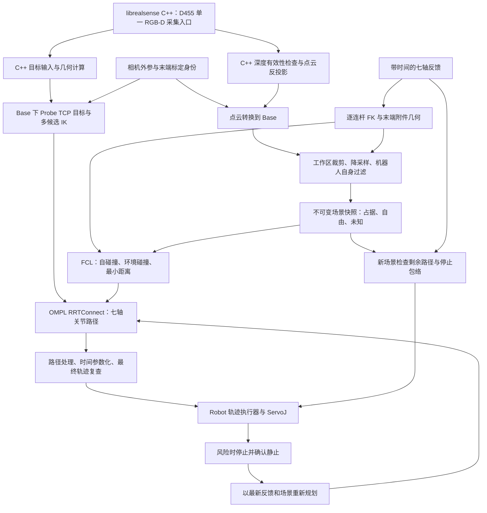

# Collision：全局相机碰撞检测与运动规划实现路线

更新日期：2026-11-03。

[模块架构与源码分层](ARCHITECTURE.md) · [只读监测启动与操作](MONITOR.md)。本文件维护实现路线、阶段验收及离线检查说明。

[实现进展](PROGRESS.md) · [OMPL 离线规划操作](PLANNING.md)。

相机快照规划已最小接通：填写 [目标关节角](config/planning.goal.example.json)，执行
`./infer/Collision/start_monitor.sh --goal infer/Collision/config/planning.goal.example.json`，窗口按 P 规划；详见 [监测操作](MONITOR.md#用当前相机场景规划)。

日常只读实时监测（已构建后，在仓库根目录执行）：`./infer/Collision/start_monitor.sh`。
当前支持 C++ 半径邻域稀疏噪点过滤，当前配置为 3 cm 内至少 5 个其他可见环境邻居；参数和橙色点含义见 [过滤说明](MONITOR.md#稀疏噪点过滤)。
相机射线遮挡过滤已开启，按当前机器人实体自动隐藏和剔除表面及后方的点，盲区保持未知，见 [遮挡盲区](MONITOR.md#相机射线遮挡盲区)。

从新保存的颈动脉点开始粗定位规划：`./infer/Collision/start_monitor.sh --coarse`，窗口按 P。
已接通首点／法向／切向 → Base 下探头 TCP → 多候选 IK → 当前相机场景碰撞检查与 OMPL；
操作及工具标定配置见 [粗定位规划](MONITOR.md#从颈动脉点开始粗定位规划)。当前仅预览，不执行运动。
模型、标定、配置和本机动态库路径由[启动脚本](start_monitor.sh)提供默认值，仍可传参覆盖；不会发送运动或停止指令。

[当前基础](#1-当前基础与缺口) · [总体架构](#2-总体架构与技术选择) · [接口边界](#3-模块数据与运行边界) · [实施阶段](#4-六阶段实施路径) · [验证清单](#6-验证清单与交付顺序)

**当前已实现纯 C++17 几何基础、FCL 检查、只读 RGB-D 监测及人工／相机快照 OMPL 规划**：提供 URDF／STL 审计、单帧占据、状态／关节段检查、RRTConnect、离线路径保存／校验重放和动画；监测窗口可按 P 从关节目标或颈动脉 TCP／IK 目标规划当前相机快照。已完成编译与离线验证；真实空间、目标及 TCP 一致性验收和运动执行尚未完成。

首期目标：利用全局 D455 相机，为 RM75 从当前姿态运动到颈部附近的非接触粗定位初始点，提供环境建模、整臂碰撞检测、七轴路径规划、轨迹执行和执行期间的停止／重规划能力。

**Collision 全部使用 C++17 实现**，包括 D455 采集、点云处理、场景建模、碰撞检测、IK、规划、轨迹处理、执行适配、录制回放、可视化和离线测试。通过 CMake 构建，不新增 Python 脚本，不使用 Python 绑定，也不通过子进程或嵌入解释器调用 Python。

首期采用“发现风险后停止，确认静止，再重新规划”。连续动态绕行、腕部跟随中的避障以及接触扫描的允许接触策略属于后续扩展。复用现有 Robot C++ 库与 Redis 接口，不以迁移 ROS 2 为前置条件。

## 0. 已实现内容与离线使用

### 0.1 软件与资源状态

- [collision_geometry](CMakeLists.txt) 库提供 [RobotModel、GeometryAudit 和 STL 接口](include/collision/robot_model.hpp)。使用 Eigen、Expat 与 OpenSSL；CMake 构建不要求 ROS、Conda、FCL 或 OMPL。
- [collision_inspect](apps/collision_inspect.cpp) 是只读离线工具，不连接相机、Redis、串口或机器人，不发送运动。它输出 JSON：URDF SHA256、关节限位、逐连杆位姿、碰撞体变换、网格审计、加载成功几何的 AABB 和 MDH 对比。
- [rm_75.urdf](rm_75.urdf) 在用户提供的 8 个机械臂连杆基础上增加 4 个附件连杆及 1 个固定支撑：共 13 个连杆、7 个转动关节、5 个固定关节，12 个 mesh 加 1 个实心圆柱碰撞体。支撑半径 65 mm、高度 500 mm，同轴位于 Base 下方，中心 z=-250 mm。保留原七轴关节及机械臂几何，采用标准 Link7，末段偏移约 144 mm；附件装配见 0.5 节。
- [Xacro 源文件](rm_75.urdf.xacro) 另含 Link7_6f（约 172.5 mm）和 Link7_6fb（约 161.2 mm）分支。当前工具只读展开后的 URDF，明确拒绝 Xacro，不运行解释器，也不自动选择或切换末端版本。标准 Link7 与真机型号仍需现场核对。
- `mesh/` 中的 8 个机械臂网格及新增 `camera.STL`、`connector.STL`、`force_sensor.stl`、`Lprobe.STL` 均已完成加载审计。保留厂家包路径，通过 `--mesh-dir mesh目录` 显式映射；底座和力传感器网格含零面积面，需用下述显式清理选项通过加载。附件的尺寸、安装变换及对真实相机、探头、线缆的覆盖仍待核实，不能据此认定完整实机包络已建立。
- 可选 [collision_checking](include/collision/collision_checker.hpp) 库与 [collision_check](apps/collision_check.cpp) 工具已实现 FCL 实体碰撞、距离、未知／过期场景拒绝与路径段检查，见 0.6 节。系统仍未安装 FCL／OMPL 开发包；本机用 Ubuntu 官方包在 `/tmp` 解包的 FCL 0.7.0、Qhull 2020.2 完成了独立构建和验证。
- 可选 [collision_monitor](apps/collision_monitor.cpp) 已接入下载的 RealSense 2.59.1 头文件及官方预编译运行库，不构建 SDK。提供相机采集、独立状态读取、单帧 OctoMap、环境／自碰撞分开报告和 GLFW 3D 显示，详见 [只读监测操作](MONITOR.md)。
- 可选 [collision_plan](apps/collision_plan.cpp) 实现人工静态场景的 OMPL 关节规划、完整复查及预览，依赖与操作见 [PLANNING.md](PLANNING.md)。无参数 `./infer/Collision/start_plan.sh` 使用合成模型演示，不代表真实 RM75。

### 0.2 构建和检查

在仓库根目录执行，以下命令均只进行构建或离线检查：

```bash
cmake -S infer/Collision -B infer/Collision/build -DCMAKE_BUILD_TYPE=Release
cmake --build infer/Collision/build -j2

# 加载全部 12 个网格；仅在内存中跳过零面积面，JSON 记录数量。
infer/Collision/build/collision_inspect --urdf infer/Collision/rm_75.urdf \
  --mesh-dir infer/Collision/mesh --drop-zero-area-triangles

# 只要求运动学审计通过；不映射网格，JSON 仍明确报告几何未就绪。
infer/Collision/build/collision_inspect --urdf infer/Collision/rm_75.urdf --kinematics-only

# 默认严格检查不丢弃任何面；底座及传感器零面积面使本命令预期返回 2。
infer/Collision/build/collision_inspect --urdf infer/Collision/rm_75.urdf \
  --mesh-dir infer/Collision/mesh
```

`--mesh-dir` 只映射 `package://rm_description/meshes/rm_75_arm/` 这一完整 URI 目录前缀，不按文件名盲目匹配其他模型，不改写、复制或移动原始 URDF／STL。它不能与 `--package rm_description=...` 同时使用；JSON 的 `mesh_directory_mappings` 记录实际映射。

也可使用具有厂家目录布局的完整模型包，将包名映射到包目录本身。下面 `/absolute/path/to/rm_description` 是需要替换的示意路径，不是已存在的模型目录：

```bash
infer/Collision/build/collision_inspect --urdf infer/Collision/rm_75.urdf \
  --package rm_description=/absolute/path/to/rm_description \
  --joints 0,0,0,0,0,0,0 --drop-zero-area-triangles
```

包目录中应存在 `meshes/rm_75_arm/base_link.STL` 等文件。支持重复 `--package NAME=DIR` 映射不同包，以及相对 URDF 的网格路径、绝对路径和本机 `file://`；不隐式查找 ROS 包、不下载模型，包内路径不得逃逸到映射目录之外。

退出码：`0` 为所选审计通过，`1` 为输入／解析错误，`2` 为声明几何未完整加载，`3` 为 URDF 与既有 RM75 末端运动学不一致。`--kinematics-only` 只允许忽略几何不完整，不能绕过模型差异或输入错误。未指定 `--joints` 时使用零位，显式输入按 `joint1` 至 `joint7` 排列，单位 rad。

### 0.3 检查边界与结果

- URDF 支持树形 fixed／revolute／continuous／prismatic 关节和 box／sphere／cylinder／mesh 碰撞几何；拒绝未知关节／几何类型、mimic、不完整关节输入、越限、非有限数、重复／断开／成环结构、DTD 和未展开表达式。只读取硬限位，不解释动力学、惯量或软限位。
- 所有 `<collision>` 均保留，包括 origin 和 mesh scale；没有碰撞体的连杆会被报告，不自动改用 `<visual>`。STL 支持 ASCII／二进制和正缩放；默认拒绝零面积面，所有模式都拒绝空、截断和非有限网格。当前不支持 DAE／OBJ，不检验网格闭合性或碰撞包络质量。
- `--drop-zero-area-triangles` 是显式、仅内存的清理选项：用缩放后的顶点和长双精度叉积判断严格零面积，不设面积阈值、不丢弃狭窄但非零面积的面。JSON 记录原始 `input_triangles`、保留的 `triangles`、跳过的 `discarded_zero_area_triangles` 及原文件 SHA256；保留所有原始有限顶点的保守包围盒。若清理后没有有效三角形仍拒绝。该选项不修复孔洞、法向、非流形或装配问题，未来模型身份需同时绑定输入摘要和清理策略。
- `local_bounds` 和输出中的 `world_aabb_m` 是几何包围盒，输出坐标根为 `base_link`；包围盒不是 FCL 碰撞结果。`declared_geometry_ready=true` 只表示 URDF 声明的几何已加载，不代表装配完整、无碰撞或可执行。
- 工具按名称检查 `joint1`～`joint7`、`base_link`～`Link7` 的映射，并允许额外固定关节；仍要求恰好七个活动关节。与现有 [MDH 实现](../Robot/src/realman_kinematics.cpp) 比较的是 `Link7`，不是附件末端，仅复用这一个源码作为离线参考，不引入任何设备代码，也不修改其参数。
- 本次零位、逐轴限位、全轴上下限和固定随机种子的 **274 组** 对比：末端位置最大差约 **3.0873×10⁻⁶ m**，姿态最大差约 **2.0027×10⁻⁵ rad**。URDF 的 `±1.5708` 旋转及轴向有舍入；软件比较容差为 20 μm／50 μrad，仅用于源码模型一致性，不是避障安全裕量，也不是空间误差上界。
- URDF 与既有 MDH 的限位存在舍入差异。工具完整报告二者及其交集，按交集采样并检查输入；不回绕第七轴或覆盖生产限位。逐连杆 URDF 坐标与 MDH 中间坐标可能不同，不能只凭末端对比就混用中间帧。
- 本机显式映射并启用零面积清理后，12 个网格共 161,582 个输入面，按声明缩放后跳过 357 个严格零面积面，保留 161,225 个，`declared_geometry_ready=true`。默认严格模式或不提供映射时仍返回几何未就绪；`collision_inspect` 仍只做几何审计，其 `physical_geometry_validated`、`self_collision_checked`、`end_effector_attachments_validated`、`ready_for_motion_planning` 均保持 false。实际 FCL 查询使用独立的 `collision_check`，避免混淆几何加载与碰撞结果。

本次真实资源审计结果如下；这些数量不代表闭合性、尺寸精度或实体安全验收：

| 网格 | 输入三角形 | 跳过零面积面 | 保留三角形 |
| --- | --- | --- | --- |
| base_link.STL | 30,289 | 326 | 29,963 |
| link1.STL | 3,792 | 0 | 3,792 |
| link2.STL | 3,806 | 0 | 3,806 |
| link3.STL | 3,562 | 0 | 3,562 |
| link4.STL | 3,714 | 0 | 3,714 |
| link5.STL | 3,682 | 0 | 3,682 |
| link6.STL | 3,914 | 0 | 3,914 |
| link7.STL | 3,432 | 0 | 3,432 |
| camera.STL | 1,856 | 0 | 1,856 |
| connector.STL | 3,076 | 0 | 3,076 |
| force_sensor.stl（缩放后） | 98,395 | 31 | 98,364 |
| Lprobe.STL | 2,064 | 0 | 2,064 |

### 0.4 在 VS Code 中预览 URDF

本机已安装 `morningfrog.urdf-visualizer` 5.2.2。打开仓库根目录作为工作区，激活 `rm_75.urdf`，
执行命令面板中的 **URDF Visualizer: Preview URDF/Xacro**（中文界面为“预览 URDF/Xacro”），
或点击编辑器右上角的眼睛按钮。另一个 `smilerobotics.urdf` 扩展只提供语言／片段支持，不提供三维预览。

原 URDF 使用 `package://rm_description/meshes/rm_75_arm/*.STL`，而实际文件位于 `mesh/`。
本机此前未配置预览扩展的包映射，厂家目录也不存在，因此其网格 URL 无法解析。
C++ 命令的 `--mesh-dir` 仅影响该次命令，不会配置 VS Code 扩展。

当前已添加兼容目录 `meshes/rm_75_arm -> ../mesh`（相对符号链接），并在工作区
`.vscode/settings.json` 中保留原配置、补充如下包映射：

```json
{
  "urdf-visualizer.packages": {
    "rm_description": "${workspaceFolder}/infer/Collision"
  }
}
```

映射指向包根目录，扩展再拼接 `meshes/rm_75_arm/`；不能直接将包名映射到 `mesh/`。
兼容链接指向同一份原始网格，没有复制、移动或改写 URDF／STL。当前工作区配置按仓库规则被 Git 忽略，
其他机器需自行合并这一设置，并保留链接与 `mesh/` 的相对布局。

更新配置后关闭旧预览面板，再从 `rm_75.urdf` 重新执行预览命令。本次使用该扩展的实际 WebView
在独立无头浏览器中完成整臂及附件渲染：12 个网格均加载，无页面错误；这不等于已操作或确认用户当前 VS Code 面板。

### 0.5 末端附件预览装配与待核对参数

按用户确认，先依据 [安装照片](mesh/picture.jpeg) 与网格端面建立可预览装配；用户随后纠正旋转方向：camera 相对 Link7 绕 +Z 旋转 −60°，Lprobe 绕同轴旋转 −30°（右手定则）。**其余安装参数及实物一致性仍待实测核对**。
固定链为：`Link7 → camera_link → connector_link → force_sensor_link → Lprobe_link`。
四个附件的 visual 与 collision 使用相同网格、原点和 `scale="0.001 0.001 0.001"`；原机械臂网格保持米制。
`camera.STL` 对应用户所说的 camer，从网格和照片看主要是相机安装支架，不能据此认定已经包含相机本体。
`Lprobe.STL` 的探头夹具也需与实际超声探头外形对照，线缆及其他未建模部件需后续补齐。

每个新增 link 的坐标系暂定为近端安装面中心，+Z 朝工具远端。固定关节 `<origin>` 表示安装位置／朝向；
visual 与 collision 的 `<origin>` 则把各自 CAD 原点、轴向转换到该安装坐标系。二者用途不同，修改 CAD 对齐时必须同步 visual 和 collision。

| 固定关节 | 父连杆 → 子连杆 | 暂定 xyz（m） | 暂定 rpy（rad） | 待核对依据 |
| --- | --- | --- | --- | --- |
| camera_mount | Link7 → camera_link | `0 0 0` | `0 0 -1.0471975511965976` | 按用户纠正方向为 −60°；暂将 Link7 原点视为法兰安装面 |
| connector_mount | camera_link → connector_link | `0 0 0.010` | `0 0 1.0471975511965976` | 抵消 camera 旋转，保持 connector 和 force_sensor 相对 Link7 的原朝向；10 mm 厚度待核对 |
| force_sensor_mount | connector_link → force_sensor_link | `0 0 0.010` | `0 0 0` | 按连接盘 10 mm 厚度，核对传感器正反面与绕轴角 |
| Lprobe_mount | force_sensor_link → Lprobe_link | `0 0 0.030` | `0 0 -0.5235987755982988` | 按用户纠正方向，相对 Link7 最终 −30°；30 mm 安装间距仍待核对 |

表中 rpy 均相对父连杆。connector 的 +60° 是固定链旋转补偿，所以 Lprobe 相对 Link7 为 −30°，不会累加为 −90°。
若以后更改 camera 的 yaw 并希望其余附件朝向保持不变，需同时反向调整 connector 的 yaw。

| 网格 | 暂定 CAD 对齐 xyz（m） | 暂定 CAD 对齐 rpy（rad） | 解释 |
| --- | --- | --- | --- |
| camera.STL | `-0.0285 0.0285 0` | `1.5707963267948966 0 0` | 圆盘中心暂取原始 `(28.5, 0, 28.5)` mm，原始 +Y 转为安装 +Z |
| connector.STL | `-0.030 0.030 0` | `1.5707963267948966 0 0` | 圆盘中心暂取 `(30, 0, 30)` mm，原始 +Y 转为安装 +Z |
| force_sensor.stl | `0 0 0.001` | `0 0 0` | 原始 Z 范围约 −1～29 mm，暂把近端包围面放在安装 Z=0 |
| Lprobe.STL | `-0.03247935 0.0315 0` | `1.5707963267948966 0 0` | 近端圆盘中心暂取 `(32.47935, 0, 31.5)` mm，夹具沿安装 +Z 延伸 |

Xacro 在所有 Link7 分支之后定义同一附件链，提供 `camera_mount_xyz/rpy`、`connector_mount_xyz/rpy`、
`force_sensor_mount_xyz/rpy`、`Lprobe_mount_xyz/rpy` 八个字符串参数；直接预览 Xacro 可调整这些参数。
默认值与展开后 URDF 一致。修改常用默认装配时需同步两份文件，当前 C++ 工具仍只读取 URDF。
本机使用预览扩展的 Xacro 解析器检查了三个 Link7 分支的展开及默认附件一致性；非标准 Link7 的两个 STL 尚未提供，不能宣称它们的几何加载通过。

当前未新增 TCP、相机光学坐标或虚构惯量。`force_sensor_link` 是预览安装坐标系，**不能直接当作生产 Sensor 标定坐标系**。
既有 Robot 标定中的传感器 +30°、Sensor→TCP 188 mm 和安装平移属于其参考帧定义，不能无坐标转换地套到 STL 原点。
用户指定的预览旋转不等于已经完成生产帧标定。待核对 CAD 基准与生产帧关系后，再决定标定变换和 TCP，避免重复计入偏移。
用户已确认当前 URDF 可继续用于开发，本轮保留其装配和角度。当前已执行 0.6 节的 FCL 离线自碰撞查询；实物尺寸和运动验证仍未记录。

### 0.6 FCL 离线碰撞与路径段检查（已实现）

核心为 [collision_checker.hpp](include/collision/collision_checker.hpp) 和 [collision_checker.cpp](src/collision_checker.cpp)。
使用 [FCL](https://github.com/flexible-collision-library/fcl) 和 [Qhull](https://github.com/qhull/qhull) 的 C++／C 接口，不调用 Python 或 ROS。
默认 `BUILD_COLLISION_CHECKING=OFF` 保留原几何工具的依赖范围；显式开启时，缺失 FCL 0.7 或 Qhull 开发库会在配置时报错，不使用占位实现。

系统已具备 `libfcl-dev` 和 `libqhull-dev` 时，在仓库根目录运行：

```bash
cmake -S infer/Collision -B infer/Collision/build-fcl \
  -DCMAKE_BUILD_TYPE=Release -DBUILD_COLLISION_CHECKING=ON
cmake --build infer/Collision/build-fcl -j2

infer/Collision/build-fcl/collision_check --urdf infer/Collision/rm_75.urdf \
  --mesh-dir infer/Collision/mesh --drop-zero-area-triangles \
  --request infer/Collision/config/offline_scene.example.json
```

**当前本机依赖位于临时目录，未安装到系统。** 复用本轮已解包的依赖和已有构建时，应使用以下命令；
`/tmp` 清理后需重新提供依赖，不能假定此路径长期存在。第三方解包配置中的 libccd 绝对引用已仅在该临时目录修正，不修改系统文件。

```bash
cmake -S infer/Collision -B infer/Collision/build-fcl \
  -DCMAKE_BUILD_TYPE=Release -DBUILD_COLLISION_CHECKING=ON \
  -DCMAKE_PREFIX_PATH=/tmp/uspilot-collision-deps/root/usr
cmake --build infer/Collision/build-fcl -j2
LD_LIBRARY_PATH=/tmp/uspilot-collision-deps/root/usr/lib/x86_64-linux-gnu \
  infer/Collision/build-fcl/collision_check --urdf infer/Collision/rm_75.urdf \
  --mesh-dir infer/Collision/mesh --drop-zero-area-triangles \
  --request infer/Collision/config/offline_scene.example.json
```

退出码 `0` 表示请求的离线状态／路径段检查通过；`2` 表示碰撞、净空不足、未知空间、过期场景或其他拒绝；`1` 表示请求解析或几何加载失败。
`status` 给出具体原因。示例默认不排除任何连杆对，当前 RM75 零位报告自碰撞并返回 **2，这是预期的诊断结果**。
工具不打开设备，JSON 中 `robot_motion_enabled` 和 `ready_for_motion_planning` 始终为 false。

**实体模型与碰撞对：** URDF 的 box／sphere／cylinder 作为实体查询；每个 STL 转为一个闭合凸包。
保留所有源有限顶点，以精确去重后构建凸包，随后检查各面与源点关系并向外扩张，面方向和邻接由 FCL 再校验。
平面网格或构建失败直接拒绝；原 STL 和 URDF 不改写。`bodies` 输出原网格摘要、凸包顶点／面数及实际最大外扩量。
外扩参数是面法向上的至少 1 μm 数值补偿，不是经过实测的避障裕量；顶点径向外扩可能更大，单独报告。
单凸包会填平凹槽，尤其相机支架和 Lprobe 夹具可能出现保守误报，后续应按结构拆分成多个有来源的凸体。

默认检查不同连杆之间的全部碰撞体对，既不排除相邻关节，也不统一跳过末端附件；同一 link 的多个 collision 作为同一刚体的联合几何，不互查自身。
`self_collision_exclusions` 只能显式列出存在的两个不同连杆和非空 `reason`，重复／无效项拒绝；仅作用于自碰撞，不影响环境查询。
模型身份绑定 URDF、原 STL 摘要、凸包策略、清理策略和排除清单。当前使用成对查询，尚未接入 broadphase。

零位、示例障碍物、默认 5 mm 示例净空且不排除碰撞对时，12 个碰撞体完成 78 次成对查询，报告以下 **12 组自碰撞**：

| 碰撞对 | 数量 | 后续处理 |
| --- | --- | --- |
| base_link–Link1、Link1–Link2、…、Link6–Link7 | 7 | 逐对核对设计安装接触及凸包重叠范围 |
| Link7–camera_link | 1 | 核对法兰接触和支架包络 |
| camera_link–connector_link | 1 | 核对安装接触和支架凹槽 |
| camera_link–force_sensor_link | 1 | 优先检查单凸包填平支架后的保守重叠，不能按“相邻”直接排除 |
| connector_link–force_sensor_link | 1 | 核对传感器安装接触 |
| force_sensor_link–Lprobe_link | 1 | 核对夹具安装接触 |

这份历史清单是空排除配置下的查询结果，不能据此直接判定实体装配有误。
用户现已确认末端固定装配正常；日常监测配置显式排除 Link7 与四个固定附件组件内部的全部 10 对，
并按用户后续要求排除 base_link–Link1 至 Link6–Link7 的 7 对活动关节相邻连杆，总计 17 对。
环境及其他未排除连杆对继续检查；原人工离线示例维持空排除，具体结果见 [PROGRESS.md](PROGRESS.md)。
本机一次 Release 检查中凸包加载约 1.10 s、单状态查询约 0.48 ms，仅是单次观测，不作为周期预算或性能保证。

**人工场景与接口：** [offline_scene.example.json](config/offline_scene.example.json) 是可运行的离线输入示例。
`scene` 必须携带 id、calibration_id、frame、captured_at_ns；`frame` 必须等于 URDF 根帧，当前是 `base_link`，单位 m／rad。
`known_space` 的 `min_m/max_m` 声明一个已经完整勘测的轴对齐空间：内部只有所列实体障碍物，其余已知自由；外部全部未知。
它不能仅凭相机视场或工作区边界填写，更不能把 RGB-D 未返回点的区域当作已知自由。
缺少 known_space、几何加裕量超出边界、未来时间戳或超过 max_scene_age_ns 均拒绝。
`captured_at_ns` 与调用者传入的 `now_ns` 必须同一时钟域；示例二者为 0，仅表示固定离线夹具，不连接实时相机。
在线时效监督及动态占据尚未接入；静态场景在一次调用期间必须保持不变。

障碍物支持 box（size_m）、sphere（radius_m）、cylinder（radius_m、length_m），位置 xyz_m、姿态 rpy_rad 均在 Base 下。
`joint_positions_rad` 按关节名称完整提供，少项、多项、非有限数或越限均拒绝；顶层与对象未知字段也拒绝，防止拼写错误静默改变策略。
默认 clearance_m=0.005 和 numerical_guard_m=0.000001 仅是示例值，不能替代实测净空预算。

**关节路径段：** 在请求顶层增加 `goal_joint_positions_rad`，工具便同时检查起点、终点和二者的关节线性插值段。
这是验证已有路径段，不是 OMPL 搜索；不重新求 IK，不做最短角回绕。
每个中点调用真实 FK 和 FCL，利用祖先转动轴到碰撞体的保守半径、后代关节偏移及移动关节全范围计算任意点的位移上界 B。
只有中点距离减去 2B 仍大于净空加数值 guard、且工作区边界余量减去 B 仍满足要求时，才接受整个区间；否则继续二分。
2B 同时覆盖自碰撞双方移动。预算用尽、取消或查询失败均拒绝，不把稀疏采样当作整段有效证明。
这一检查依赖双精度 FCL 查询及所配数值 guard，不调用把两个末端刚体位姿直接插值的连续碰撞近似。
`certified_clearance_lower_bound_m` 只在整段 valid 时使用；它针对当前保守几何与静态场景，不含实体误差或动态停止包络。

核心 API 为 `CheckState` 和 `CheckSegment`，结果携带模型、场景、标定及采集时间，返回具体碰撞体对、距离、拒绝原因及检查计数。
历史几何、碰撞及 CLI 验证记录见 [PROGRESS.md](PROGRESS.md)。按用户要求，当前只保留功能实现，测试程序已移除。
只读相机场景已推进至 0.7 节，OMPL 与颈动脉目标 IK 已接通；下一步核对凸包、安装接触策略和真实目标，再接执行。

### 0.7 只读实时监测与回放（已实现）

入口、构建、硬件连接、回放与录制步骤见 [MONITOR.md](MONITOR.md)。当前监测目标是观察 Base 下点云、实际机器人姿态和风险，不发送运动或停止命令。
`--replay` 不访问设备；显式 `--live --robot-ip ...` 才打开独立的状态查询连接和指定 D455。
SDK 头文件使用用户提供的 `librealsense/include`，缺失的匹配运行库以官方预编译包补到忽略目录 `.deps/realsense`，没有 SDK 源码构建步骤。
`--sdk-info` 已验证头文件 `2.59.1` 与运行 API `25901` 匹配。

单帧建图只将有效深度射线经过体素记为自由，端点膨胀为占据；机器人过滤端点保留未知，未知空间不能由人工框替代。
历史合成回放、录制、OctoMap/FCL 查询和只读传输验证见 [PROGRESS.md](PROGRESS.md)；实际采集帧率、时序和独立空间精度仍待验证。
检测使用全部非机器人观测，不做人体分类。人工场景和相机快照 OMPL 均已接通；连续建图融合、生产 Robot 反馈桥接和停止监督仍待完成。

## 1. 当前基础与缺口

以下现状依据当前工作区源码；部署和验收状态还需结合实际配置与现场记录确认。表中现有 Python 文件仅作为当前行为、数据来源和算法的参考；Collision 用 C++ 实现相应功能，不调用这些脚本作为运行前置步骤。

| 环节 | 当前已实现／可复用 | 计划新增 | 仍需实测 |
| --- | --- | --- | --- |
| RGB-D | 现有 [cliff_demo.py](../Camera_RT/cliff_demo.py)；Collision 已提供 C++ D455 点云及设备／时序接口，完成编译和合成回放 | 完善生产感知、跨帧场景与采集时间匹配 | 实际采集、帧率、有效深度覆盖、端到端延迟 |
| 外参 | [transform_point.py](../hand_eye_calibration-main/transform_point.py) 为既有参考；Collision C++ 已加载／校验色彩光学系到 Base 的标定并记录摘要 | 扩展目标及执行上下文的身份绑定，标定变化使旧计划失效 | 工作区内独立定位误差；颜色与深度坐标约定一致性 |
| 机器人运动学 | 既有 [RMKinematics](../Robot/include/realman_kinematics.hpp) 提供末端 FK；Collision 已提供 URDF 逐连杆 FK、附件固定链、碰撞原点变换及末端 MDH 对比 | 确认 URDF 中间帧与 Robot 的集成映射，补齐未覆盖部件 | 连杆和末端模型与真实装配的一致性 |
| 坐标与末端 | [CalibratedFrameChain](../Robot/include/calibrated_frame_chain.hpp) 管理 ArmTip、Sensor、Tool、Probe TCP 等关系；四个附件 STL 已接入预览 | 核对附件 CAD 安装帧与生产标定帧，再绑定碰撞几何 | 装配变化后的 TCP、旋转和几何尺寸 |
| 粗定位目标 | 既有 [run_probe_target.py](../hand_eye_calibration-main/run_probe_target.py) 调用 MoveJ_P；Collision C++ 复用首点及姿态，按用户要求沿外法向后退 200 mm，读取 TCP 标定、多候选 IK 后做碰撞规划，仅读不运动 | 为目标增加曝光时间及相机／受试者身份，接入生产状态与执行 | 目标几何、TCP、可达性和实际净空 |
| 运动发送 | [RMCommand](../Robot/include/realman_command.hpp) 提供反馈、ServoJ、发送状态和停止接口 | Robot 内的关节轨迹执行与监督、粗定位控制权 | 发送周期、跟踪误差、取消和制动行为 |
| 原控制规划 | [Rm75ServoPlanner](../Robot/include/rm75_control.hpp) 提供增量 IK、关节与速度／加速度等检查 | 全局规划和关节轨迹检查适配，复用已有保护 | 全局规划与执行保护的一致性 |

现有增量 planner 不等于全局避障规划器，也不能直接作为远距离目标的完整 IK 求解器。现有粗定位只执行单次 MoveJ_P，尚未把人体和环境加入整臂路径检查。

截至本次文档编写，[全局相机进展](../../.runme/Progress/camera-rt-progress.md) 记录新 D455 标定已部署，同批次位置一致性 RMS 为 2.670 mm、最大为 7.487 mm，独立验证仍为 false。拟合残差不能作为工作区误差上界；后退 200 mm 只是 TCP 目标偏置，不能作为全臂净空证明。

## 2. 总体架构与技术选择

下图为完整链路目标，目前已实现几何加载／FK／资源审计、FCL 查询、关节段检查、只读 RGB-D 单帧监测及相机场景搜索；颈动脉 TXT 已能经 C++ 生成 TCP 目标并求 IK。跨帧建图、生产状态接入与执行尚未完成。Collision 负责采集、目标几何、碰撞和规划，Robot 保持唯一运动发送者。当前兼容既有视觉保存的目标文件，不调用其 Python 运动入口；C++ 直接选点和法向估计仍为后续功能。



| 技术 | 计划用途 | 接入原则 |
| --- | --- | --- |
| C++17、Eigen | Collision 全部模块与数值计算 | 与 Robot 共用运动学及坐标定义，避免复制出第二套参数 |
| Expat、OpenSSL | 已接入 URDF XML 解析与输入／网格 SHA256 | 限制输入规模，拒绝 DTD／未展开 Xacro；模型数据保留原值 |
| librealsense C++ API | 已提供只读源：原始深度点云、深度→彩色外参、设备身份和时间域读取；实机待验证 | 单一采集拥有者；使用下载的头文件与匹配预编译库，不构建 SDK |
| FCL | 已接入实体碰撞、距离与 OctoMap 查询；broadphase 加速仍待开发 | 自碰撞和环境碰撞都检查；调用方决定有效状态和净空规则 |
| OMPL／RRTConnect | 在七轴有界关节空间搜索路径 | 通过 FCL 实现状态与路径段检查；普通关节空间规划只针对固定场景快照 |
| OctoMap | 已接入单帧射线占据／自由／未知场景，跨帧融合待开发 | 未知空间由应用显式处理，不能只检查 occupied 后默认其余都可走 |
| Open3D C++ API | 点云整理、局部法向估计、选点、离线可视化和几何对齐检查 | 直接链接 C++ 库，不使用 Open3D Python 包 |
| 现有 JSON 头文件与 C++ 标定接口 | 读取相机／末端标定、配置和目标数据 | 保留单位、方向、身份和矩阵校验，不能只复制转换公式 |
| hiredis 与 Robot 线程边界 | C++ 模块间意图／状态通信，Robot 控制权管理 | 不把整幅点云作为高频控制意图广播；大数据走独立、容量有界的 C++ 传输适配 |
| CMake 与 C++ 功能工具 | 构建、离线检查与回放 | 录制、回放和可视化入口均为 C++ 可执行程序 |

版本组合、FCL 的 OctoMap 支持、librealsense／Open3D C++ 库与 Robot 的编译兼容性，应在开发初期通过最小编译样例核对。构建和运行使用 C++ 依赖，不要求激活 Conda 环境。本文不声明这些依赖已经安装，也不承诺规划耗时。

## 3. 模块、数据与运行边界

### 3.1 计划目录

当前目录与扩展归属如下。标注“规划”的内容尚未创建，不能当作可用入口。

```text
infer/Collision/
  README.md              # 本实现路线
  MONITOR.md             # 已实现：只读实时监测／回放操作
  ARCHITECTURE.md        # 已实现：系统概览与源码分层
  PROGRESS.md            # 已实现：进展与验证记录
  PLANNING.md            # 已实现：OMPL 离线规划与路径回放操作
  rm_75.urdf             # 用户提供：当前几何输入
  rm_75.urdf.xacro       # 用户提供：含末端变体，仅供来源参考
  mesh/                  # 用户提供：8 个机械臂及 4 个附件 STL
  CMakeLists.txt         # 已实现：几何库、可选 FCL／OMPL／监测库及功能工具
  include/collision/     # 已实现：几何、碰撞、体素、监测和只读源接口
  src/                   # 已实现：模型、网格、FCL、体素和监测处理
  apps/                  # 已实现：审计、碰撞检查、监测 CLI 与 3D 窗口
  config/                # 已实现：人工静态场景及监测初值配置
  librealsense/          # 本地下载 SDK；忽略，不自动构建
  .deps/                 # 本地预编译运行库；忽略
```

模型大文件、真实录制、日志和本机缓存不随代码提交。真实尺寸、标定文件和经验证配置有明确来源；不使用占位模型冒充已验证装配。

### 3.2 最小接口

下表描述完整链路的目标接口；当前可调用的几何 API 见 0.1 节，`CollisionChecker::CheckState/CheckSegment` 及人工 `CollisionScene` 见 0.6 节。
相机场景、目标、规划和执行接口仍为规划，不预先固定 Redis key 或在线序列化格式。核心能力以 C++ 库提供，进程间适配同样由 C++ 实现。

| 模块／类型 | 最小输入 | 最小输出与职责 |
| --- | --- | --- |
| `CameraSource` | D455 设备和流配置 | 同源 RGB-D、内参、深度尺度、设备／帧身份及时间；管理设备生命周期 |
| `TargetInput` | 已确认的 Base 下 Probe TCP 位姿，或同源点云选点／切向与局部法向 | 带采集时间、目标身份和标定摘要的 TCP 目标；用 C++ 完成姿态与后退偏置计算 |
| `SceneBuilder` | RGB-D、实际内参／深度尺度、设备与帧身份、外参、时间匹配的关节反馈、静态障碍物 | 生成 `SceneSnapshot`；维护占据、观测自由和未知空间 |
| `SceneSnapshot` | 建图结果 | 不可变场景、场景版本、观测覆盖／时间范围、设备身份、外参与建图配置摘要 |
| `RobotGeometry` | 七轴 `q`、共用运动学、附件固定变换、几何配置 | 每个碰撞体的 Base 位姿、模型身份、经核对的自碰撞对配置 |
| `CollisionChecker` | `q` 或关节路径段、固定场景、几何和裕量配置 | 有效性、首个拒绝原因、最近碰撞体对、距离或未知／不可评估状态 |
| `GoalIK` | Base 下 Probe TCP 目标、当前关节状态、末端标定、限位与求解预算 | 多个候选关节解；每个解带位姿残差，经限位和碰撞检查后使用 |
| `Planner` | 当前 `q`、有效目标解、固定场景、规划预算／随机种子 | `PlanResult`：成功／失败、关节路径、起点、目标身份、场景／标定／模型／配置身份、耗时 |
| `TrajectoryProcessor` | 关节路径、速度／加速度限制、执行插值约定 | 带相对时间的关节轨迹及复查结果；平滑、重采样和插值改变后重新检查 |
| `ExecutionSupervisor` | 最终轨迹、真实反馈、最新场景、当前控制权、发送状态 | 执行进度、停止／取消／故障／完成状态；只通过 Robot 已有发送层下发 |

距离查询失败、返回非有限数或不支持的几何组合，应返回“不可评估”并拒绝该状态，不能解释为零风险。无解、预算耗尽与数值故障应分别报告。

### 3.3 坐标、时间和身份

- 统一使用 m、rad；所有场景和碰撞体查询在 RM75 Base 下完成。`T_A_B` 将 B 坐标映射到 A。D455 光学系、ArmTip、Sensor、Tool 和 Probe TCP 不混用，沿用现有标定链。
- 有限位的关节按真实有界区间建模；不得为求“最短旋转”而把第七轴无条件当作无限连续转轴，或用角度回绕绕过限位。
- 保留相机原始时间和时钟域，将可用于时效判断的时间映射到主机单调时钟，并记录映射有效性／误差。不能以文件修改时间、心跳时间或发布时刻刷新采集年龄。
- 机器人反馈时间目前是主机接收时间，不是假定的控制器曝光同步时间。自身过滤需使用与图像采集时间匹配的反馈；无法匹配时，该帧不生成可执行场景。
- 场景要携带观测覆盖的时效，合并旧帧不能仅通过更新场景发布时间掩盖旧数据。目标也需携带源帧、采集时间和外参身份。
- 计划绑定场景版本、机器人模型、标定和约束配置。规划结束到执行开始之间必须以最新场景和真实起点复查；身份变化使原计划失效。正常场景更新触发剩余路径检查，不要求每帧都无条件停止。

### 3.4 线程和控制权

采集／建图、OMPL 搜索、执行监督与 Robot 周期分离。FCL 和 OMPL 的搜索工作不得阻塞现有 10 ms 控制周期；控制周期读取有界、已准备好的结果及监督状态。

规划期间使用不可变场景；并行查询采用线程独立的 FCL 变换／查询对象，避免并发修改同一碰撞体。场景传输适配保留完整身份与时间，使用有界队列／最新快照，失去连接或超时使场景失效。

规划中的粗定位执行分支纳入 Robot 的运动所有权管理，不由相机或 Collision 进程直接打开第二条运动发送链。粗定位、腕部跟随和力控同一时刻只能有一个执行者。切换顺序为：撤销旧意图、停止并确认静止、清理待发送目标、核对新起点和上下文，再授予新执行者控制权。

## 4. 六阶段实施路径

### 阶段 1：几何基础

**进度：软件几何加载、逐连杆 FK 和离线审计已实现；机械臂及四个附件共 12 个网格已通过显式清理加载，附件预览装配已建立；安装参数、自碰撞及实物几何验证尚未完成，不能标记阶段验收通过。**

- 已从用户 URDF 计算逐连杆位姿，并复用既有 MDH 做末端数值对比；保留不同中间帧的区别，后续集成时显式核对关节正方向、零位和模型原点。
- 用覆盖真实外形的胶囊体／凸包建立连杆模型，必要时使用简化网格；包括底座、肘部、腕部、传感器、探头、支架和腕部相机。线缆采用保守包络或明确工作区限制。
- 附件挂接到实际固定坐标系；探头替换、旋转调整和 TCP 更新必须同步改变模型身份。现有 STL 只能覆盖其实际对应部件，不能替代全部末端几何。
- 自碰撞只排除经几何确认的设计接触对，不能统一忽略所有相邻或所有末端碰撞体。

**完成条件：** 离线验证零位、限位附近和多组姿态的逐连杆 FK；最终变换与原末端 FK 一致；现场多姿态叠加／测量覆盖肘部与全部附件，记录几何误差及未覆盖部位。

### 阶段 2：环境建模

**进度：已实现 C++ 只读相机／反馈源、彩色光学系到 Base 转换、保守过滤、单帧 OctoMap 和未知空间拒绝；已完成编译及合成回放，真实空间／时序、跨帧融合、生产反馈桥接仍待验证或开发。**

- 使用 librealsense C++ API 实现唯一 D455 采集拥有者，为 C++ 目标工具与快速深度支路提供同源帧；录制和可视化不能阻塞场景刷新。相机退出后粗定位不能继续使用旧快照，禁止并行启动现有相机脚本争用同一设备。
- 根据实际内参和深度尺度反投影，转到 Base，进行工作区裁剪与受控降采样。低通或多帧融合的滞后必须计入观测年龄。
- 无效深度和孔洞保留为未知，不能沿用当前目标点逻辑中的“全图最近非零深度”补点。机器人自身过滤保守设置，不能把贴近连杆的人体误删为自由空间。
- 静态床体和固定设备用人工几何补充；动态占据通过新鲜有效射线更新，机器人掩膜、遮挡和单纯超时不得清除成自由空间。旧动态体素过期后回到未知或保守占据。
- 未观测的人体内部、背面、视野外和被机械臂遮挡区域不得默认可穿越。仅允许路径进入已确认自由且满足裕量的区域；必要时增加禁入体积或第二视角。无路可走时报告覆盖不足。
- 首期用 Open3D C++ API 完成点云整理、局部法向估计和可视化，不依赖 CLIFF／SMPL。后续如接入人体模型目标或补全数据，先独立完成米制坐标对齐与误差评估，且不能覆盖真实占据观测。

**完成条件：** 录制场景能重建人体、床和测试障碍物；验证坐标对齐、自身过滤、未知区域、旧占据更新与遮挡恢复；独立验证外参及点云几何，不以拟合残差代替。

### 阶段 3：FCL 碰撞与距离检查

**进度：人工静态场景和单帧 OctoMap 查询、实体距离及带位移上界的关节段检查已实现；已提供相机只读源，尚未完成实机验证、自碰撞豁免及凸体细化，完整阶段尚未验收。**

- 实现全臂自碰撞、全臂／附件与环境碰撞，以及最小净空查询。应用层额外检查未知空间，OctoMap 已占据体素的查询不能替代该检查。
- 将关节限位、几何有效性、碰撞和裕量合为状态有效性检查，并提供定位到具体碰撞体对的结果。
- 为路径段实现基于连杆空间位移与裕量的自适应细分，配合保守位移界或扫掠包络；达到细分预算仍不能确认有效时拒绝。
- FCL 连续检测只在确认支持的形状和运动模型上使用。不能仅用连杆两个端点的刚体插值，假定其等于关节链实际运动。

**完成条件：** 覆盖相交、分离、近距离、完全包含、非相邻自碰撞、探头／支架碰撞，以及“端点有效而中间扫过障碍物”；检查失败与未知区域均不得误报通过。

### 阶段 4：OMPL 七轴路径规划

**进度：已实现人工场景的有界关节 RRTConnect、精确解、检查约束的简化、全路径复查、保存／校验重放及动画；监测入口已接通相机快照规划及颈动脉 TCP 多候选 IK。真实目标、TCP 与 RM75 路径验收仍待完成。**

- 输入真实当前关节状态和 Base 下 Probe TCP 目标，通过现有坐标链转换目标；目标必须有新鲜来源和正确标定身份。
- 目标接收、体表点／切向／法向到 TCP 姿态的几何计算和后退偏置均在 C++ 中完成；不能把调用 `run_probe_target.py` 作为规划入口。体表选点只提供几何目标，不自动证明其对应真实血管。
- 实现多初值数值 IK，以当前构型及不同冗余构型生成候选解，检查位姿残差、限位、奇异性与碰撞。没有有效目标解时停止该次规划。
- 使用七维有界状态空间、RRTConnect、FCL 状态／路径段检查和有限规划预算；不把需要精确到达的粗定位请求的近似解当作成功。
- 对找到的路径进行受碰撞检查约束的简化，再完整复查。记录随机种子、预算、候选目标、场景身份、失败原因和耗时，支持录制场景重放。

**完成条件：** 对可绕行场景返回有效七轴路径；对起点碰撞、目标碰撞、不可达、通道过窄、未知遮挡、预算耗尽和取消给出明确结果，不自动退回原单次 MoveJ_P。

### 阶段 5：轨迹处理与 Robot 执行

- 将几何路径转换为满足现有关节速度／加速度限制的带时间轨迹，按 Robot 当前 10 ms 请求周期及实际发送限制生成样本。该周期是接入约束，不是已测得的硬实时保证。
- 验证执行器实际采用的插值、关节路径、起止速度和停止包络。时间参数化若改变几何路径，或后续执行插值改变路径，均重新进行完整检查。
- 在 Robot 增加受相同硬件、通信、限位和故障保护约束的关节轨迹执行分支。不能只给 MoveJ_P 最终 TCP 位姿，也不能把关节路径转为 TCP 后再求 IK 改变肘部构型。
- 针对现有单槽 ServoJ mailbox，跟踪提交、消费、发送、结果及实际反馈；禁止突发灌入整条轨迹。发送延迟／覆盖导致实际运动偏离已验证包络时停止，不跳过中间段后继续追赶。
- 开始执行前重新核对起点和场景；完成需要实际关节／TCP 残差、速度及静止条件满足要求，不能只凭最后一次提交成功判定。取消与故障走已有停止和静止确认机制。
- 粗定位完成并静止后仅交出控制权；接近和力控仍须经过其现有入口检查，不能由 Collision 直接启动接触扫描。

**完成条件：** 固定障碍物低速实测中，真实轨迹保持在检查过的几何／误差包络内；验证发送延迟、覆盖、反馈过期、跟踪偏差、人工取消及控制权交接。

### 阶段 6：在线监督与停止后重规划

- 执行期间持续用新鲜场景和真实反馈检查剩余路径的近期运动及制动包络，检查范围至少覆盖完整感知、反应和停止时域。
- 发现净空不足、未知区域侵入、场景失效或计算无法按期完成时，由 Robot 停止并确认静止。不能等重新规划完成才决定停止。
- 静止后，以真实停下的关节状态、新场景和仍有效的目标重新规划；禁止沿用旧起点、旧轨迹游标或旧速度直接续跑。
- 仅同一有效请求、粗定位控制权仍有效、非故障的场景变化停止，允许成功复查后重新执行。取消终结请求；通信故障、观测失效或身份变化保持停止并等待新的有效请求。
- 重规划次数、总等待时间和单次计算预算有界；超预算结束本轮并保持停止。停止失败保留 Fault，不能宣布“已停止”或启动其他模式。

**完成条件：** 在受控移动障碍物场景验证风险发现至静止的总延迟、停止包络、重新规划与恢复；确认人体突然移动、相机断连、深度失效和计算拥塞不会造成旧路径继续执行。

## 5. 参数、失败处理与观测

### 5.1 实测后冻结的配置

以下参数均待测量和验收，不提供可直接用于真人场景的默认数值。可用保守临时配置完成离线／固定障碍物调试，但必须标为未验收。

| 配置 | 确定依据 |
| --- | --- |
| 工作区、禁入区、未知空间策略 | 相机覆盖、床体、机器人自遮挡和实际运动范围 |
| 体素尺寸、降采样和场景刷新周期 | 最小需检测物体、保守离散化误差和更新耗时 |
| 外参／深度／模型误差裕量 | 独立工作区测量、深度边缘与孔洞、完整末端尺寸 |
| 观测年龄、时间匹配和映射误差上限 | 采集至监督的尾部延迟与时间同步实验 |
| 规划预算、路径段细分和 IK 容差 | 代表场景成功率、最小净空、运动学一致性 |
| 执行速度、加速度及跟踪容差 | 真实发送周期、反馈延迟、负载和跟踪测试 |
| 监督周期、停止距离与静止判据 | 障碍物运动速度、检测／发送／制动延迟和实测停止包络 |
| 重规划次数与累计等待时限 | 计算资源、场景变化和本轮任务时限 |

净空预算至少覆盖外参、深度、体素、几何和跟踪误差，机器人在反应及制动期间的扫掠，以及障碍物在整个时域内可能的位移。各项明确计入位置，避免重复扣减或漏算。仅凭 TCP 速度不能确定肘部的速度和制动扫掠。

### 5.2 失败行为

| 情形 | 计划行为 |
| --- | --- |
| 无效深度、未知／遮挡区域 | 不生成该区域可自由通行的结论；路径进入则拒绝，覆盖不足时结束本次规划 |
| 图像与反馈不能匹配、场景过期 | 开始前拒绝；执行中停止；新发布时间不能刷新旧观测 |
| 标定、装配模型或关键配置变化 | 废弃旧计划；执行中停止，重新建立有效上下文 |
| 起点／目标碰撞、目标不可达 | 报告具体原因；不自动执行退让或回到原 MoveJ_P |
| 无路径、预算耗尽、数值／距离查询失败 | 返回对应失败，保持停止；不能按近似解或不完整检查结果执行 |
| 新障碍物进入轨迹或停止包络 | 停止优先；确认静止后按有效请求规则重新规划 |
| 发送失败、严重跟踪偏差、反馈失效 | 故障停止；不将旧轨迹自动续接到恢复后的反馈 |
| 人工取消／终止 | 撤销该请求、清理待执行目标并确认停止；禁止自动恢复 |
| 停止未被确认 | 保持 Fault 并报告失败；不交接控制权 |

### 5.3 记录与性能

每次计划与执行记录目标／请求身份、场景版本、标定与模型摘要、源采集时间、随机种子、净空配置、路径、执行反馈和停止原因。日志异步有界，记录丢弃计数，不阻塞 Robot 周期。

测量采集／建图／发布／监督延迟，单次状态与路径段检查耗时，规划耗时和成功率，实际 ServoJ 间隔、跟踪偏差、最小净空以及风险发生到确认静止的时间／距离。报告中同时给出分位数、最大观测值、测试负载与样本数；平均帧率不能替代尾部延迟验收。

## 6. 验证清单与交付顺序

已实现几何、实体碰撞、距离、路径段、监测、SDK 链接和人工场景规划功能。测试源码已按用户要求移除，历史验证记录见 [PROGRESS.md](PROGRESS.md)。下表为完整链路目标验收清单：真实感知、目标／TCP 实体一致性、执行和真机项尚未完成。

| 层次 | 测试场景 | 通过依据 |
| --- | --- | --- |
| 离线几何 | 多关节姿态、限位、模型原点、附件变换、末端 FK 一致性 | 数值误差和几何覆盖满足已声明容差 |
| 离线感知 | 有效深度、全零深度、孔洞、遮挡、自身过滤、外参错配、旧帧回放 | 占据／自由／未知语义正确；拒绝旧数据与身份不一致 |
| 离线碰撞 | 自碰撞、环境碰撞、完全包含、附件碰撞、薄障碍物、仅中间段碰撞 | 预期碰撞全部检出；距离失败和未知空间不误判通过 |
| 离线规划 | 可绕行、不可达、无有效 IK、起终点碰撞、窄通道、取消、超时 | 成功结果经独立复查；失败结果不能进入执行 |
| 执行回放／假传输 | mailbox 覆盖、迟发、反馈间断、时间跳变、场景／模型变化 | 保护与状态转换符合约定，无旧意图恢复或双发送者 |
| 独立空间验证 | 未参与拟合的多位置／姿态、点云与真实障碍物／连杆对齐 | 建立可用于裕量设计的工作区误差记录 |
| 固定障碍物低速真机 | 模型障碍物绕行、最小净空、取消、停止、控制权交接 | 真实运动与已检查路径／误差／停止包络一致 |
| 受控移动障碍物 | 路径侵入、遮挡、断连、场景滞后、停止后重规划 | 在已验证时域内停止，重规划使用实际停下的状态 |

交付顺序为：几何与独立空间验证 → 录制场景建图及碰撞回放 → OMPL 离线规划 → 假传输执行验证 → 固定障碍物低速真机 → 受控移动障碍物。前一层发现的问题先修复并回归；人体场景安排在空间精度、执行和停止包络验证之后。

Collision 的 CMake 功能构建及几何、FCL、监测和 OMPL 入口已建立，规划验证边界见 [PROGRESS.md](PROGRESS.md)。后续回放由 C++ 工具执行。检查通过只表示对应层通过，不能将源码检查、编译或可视化结果写成实体避障验收。

## 7. 后续扩展与维护

- 增加第二相机、经深度约束的人体体积补全，以改善盲区；更新感知误差和观测融合的验收。
- 连续动态绕行需要考虑时间的场景预测、动态轨迹有效性和在线更新，不能仅加快 RRTConnect 调用频率。
- 将监督接到腕部跟随与接触扫描前，单独定义探头可接触的局部体表、方向、力和允许误差；其他连杆及附件继续避障，不能全局禁用人体碰撞。
- 正式落地跨模块接口和控制权策略时，在 [DECISIONS.md](../../DECISIONS.md) 追加对应决策，同步 [系统架构](../../ARCHITECTURE.md)、[Robot 架构](../Robot/ARCHITECTURE.md)、[Camera_RT 架构](../Camera_RT/ARCHITECTURE.md) 和运行文档。本次仅落实独立几何基础和离线入口，尚未改变生产控制接口。

相机与标定操作参考 [Camera_RT 操作](../../.runme/run/camera-rt-operations.md)、[标定说明](../hand_eye_calibration-main/README.md) 和 [标定操作](../../.runme/run/calibration-operations.md)。现有定位入口和机器人生产入口可能发送真实运动；本文不是执行这些入口的启动脚本。
